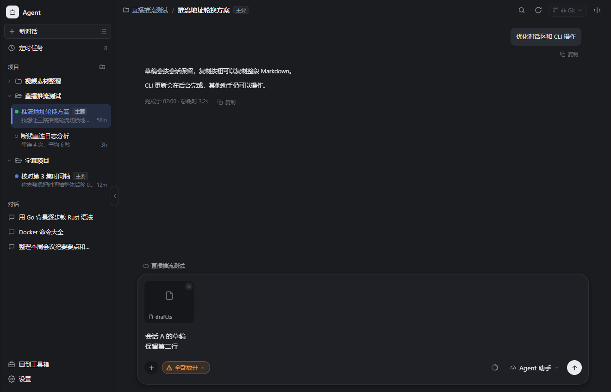

# Agent 对话与 CLI 体验优化

输入草稿按会话分别保存；新对话按所属项目区分。正文、附件和网页注释在切换聊天、打开设置和刷新后保留。草稿使用当前窗口的 sessionStorage，存储最近 50 份非空草稿；关闭窗口后的恢复不在本次保证范围内。

发送被后端拒绝时，内容回到所属会话的草稿。等待期间新增的输入也会保留，附件和注释去重。新会话创建期间切换页面，完成后继续后台发送，并保留提交时的模型、思考强度和批准方式。

用户消息、完成的助手回答和旧格式代码块提供复制按钮。助手回答复制 Markdown 原文。复制成功有反馈，失败有提示。中文输入法确认及长按 Enter 不会误发。

CLI 黄条显示每个待更新助手的按钮，各自独立显示忙状态。点击更新立即收起弹窗，更新在后台继续，可以更新其他助手、关闭提醒和切换页面。成功时收起对应提醒并提示完成；失败提供反馈和重试入口。没有返回版本的离线检查保留已知提醒；过期访问、乱序检查和更新前的旧结果不会恢复过时版本提示。

## 验证

- `npm run check:agent`：154 项断言，覆盖草稿恢复、发送期间切换会话、提交选择、流式消息、滚动跟随、停止、CLI 检测、并发更新、离线和乱序返回。
- `go test ./internal/catagent ./internal/service/cat -run '^TestCLIUpdate' -count=1`：通过。
- 前端生产构建与三种语言键检查通过。
- Edge 浏览器走查：草稿切换、项目隔离、设置往返、刷新、完整复制、被拒绝发送恢复、历史滚动、并发后台更新、关闭后重入、完成自动收起，以及深浅主题和窄布局。CLI 安装使用可控制完成顺序的测试绑定，未执行真实安装。
- 全量 API 自检仍有既存的 RL 勾选合并、D3 音频缩略图、G6 直播地址错误清除三项失败；Agent 专项通过。

