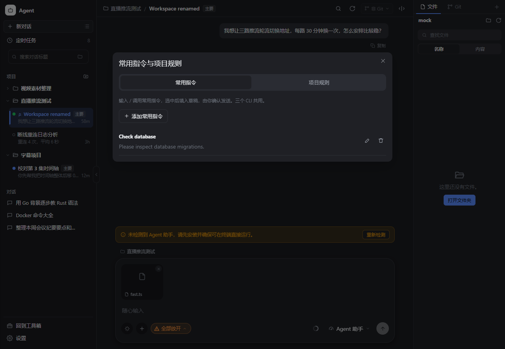

# Agent 功能对比与补全（2026-10-15）

ffc 的 Agent 是 Grok Build、Claude Code、Codex CLI 的统一桌面工作区。比较重点是日常工作是否顺畅、数据能否保留以及操作是否有真实效果。

## 调研依据

已阅读以下公开文档：

- [Claude Code 交互模式](https://code.claude.com/docs/en/interactive-mode)：快捷命令、会话操作、提示输入和消息排队。
- [Claude Code 检查点](https://code.claude.com/docs/en/checkpointing)：真实文件快照、会话回退、分叉和恢复范围。
- [Claude Code 项目记忆](https://code.claude.com/docs/en/memory)：全局与项目指令。
- [Cursor Rules](https://cursor.com/docs/rules)：项目规则、用户规则、AGENTS.md 和作用范围。
- [Cursor CLI 快捷命令](https://cursor.com/docs/cli/reference/slash-commands)：模型、会话、MCP、规划和审查等入口。
- [Cursor Agent Review](https://cursor.com/docs/agent/agent-review)：手动或自动审查、本地改动比较和审查深度。
- [VS Code 会话管理](https://code.visualstudio.com/docs/copilot/chat/chat-sessions)：置顶、归档、筛选、恢复和工作区会话。
- [VS Code Prompt Files](https://code.visualstudio.com/docs/copilot/customization/prompt-files)：复用任务指令、用户与工作区范围、手动调用。

Codex 官方网站在本环境返回 HTTP 403，未据此作功能声明。使用本机 `codex-cli 0.162.1` 的 `codex --help` 和 `codex exec --help` 验证了 `exec/resume/fork/review/queue`、MCP、app-server、worktree 等命令。它们是 CLI 能力；是否能在 ffc 界面使用仍取决于适配器和其他 CLI 的协议。

## 比较结果

| 工作环节 | 竞品参考 | ffc 状态与本次改进 |
| --- | --- | --- |
| 会话整理 | VS Code 置顶、归档、筛选；Claude/Cursor 会话命名 | **新增重命名、置顶、归档、恢复和标题筛选**，写入本地数据库 |
| 会话携带与分享 | Claude `/export` | **新增 Markdown / JSON 导出**，从所选 CLI 的原生会话记录读取 |
| 常用工作流 | VS Code Prompt Files、Cursor slash commands | **新增全局常用指令库和 `/` 选择器**；选择后填入草稿，再由用户发送 |
| 项目约定 | Claude 项目记忆、Cursor Project Rules | **新增项目规则编辑器**，每轮与已有全局指令一起传入，项目之间隔离 |
| 文件上下文 | Cursor Context、VS Code 文件引用 | **新增 `@` 文件搜索和选择**，将真实路径放入现有附件系统 |
| 审查与规划 | Cursor Agent Review、Codex review、Claude plan | **新增 `/review`、`/test`、`/explain`、`/plan` 内置任务指令**；审查和规划先提供草稿，不自动触发模型调用 |
| 对话内容查找 | 各家会话搜索 | 已有按问答搜索与跳转，本次保留，并加入 `/search` 入口 |
| Git 工作流 | IDE Source Control | 已有未推送提交数、历史与详情、差异、暂存、stash、分支和同步操作 |
| 工作区工具 | IDE 文件树、终端与预览 | 已有文件、终端、浏览器和产物预览 |
| CLI 安装维护 | 各家诊断和更新入口 | 已有入页静默检测、后台并发更新、可关闭提示和版本检查 |
| 扩展复用 | 各家 Skills / MCP | 已有全局与项目共享技能/MCP，写入每家原生发现路径，保留外部配置 |
| 长任务与通知 | 各家后台任务 | 已有后台流式执行、取消、任务状态、系统通知、定时任务和失败重试 |
| 输入体验 | 草稿、附件、命令补全 | 已有分会话草稿与发送失败恢复；本次补键盘选择、中文指令筛选和异步结果隔离 |

## 使用入口

- 对话行的 `···`：重命名、置顶、归档、导出、删除。
- 侧栏上方：按标题搜索；文件夹图标切换到归档列表，恢复操作仍在 `···` 中。归档不会停止正在运行的回复，也不会删除 CLI 历史或项目文件。
- 输入框左下角的指令按钮，或 **设置 → 常用指令与项目规则**：管理常用指令和项目规则。
- 输入 `/`：选择快捷操作；也可以输入指令名称中的中文或英文进行筛选。
- `/new`、`/search`、`/export`、`/rules`、`/prompts`、`/skills` 是应用操作。
- `/review`、`/test`、`/explain`、`/plan` 是可编辑的提示词草稿，不等同于切换原生 CLI 模式。实际执行权限由输入框已有的权限模式控制。
- 输入 `@文件名`：搜索当前对话工作区；项目新对话也能搜索项目文件。选中后显示附件卡片，发送前可移除。普通新对话尚无工作区，可使用文件选择按钮。
- 导出弹出系统保存窗口，可取消；Markdown 保留正文与代码块，附件以名称列出，不打包本地文件。JSON 包含原生消息和现有元数据。没有可读原生记录时给出错误，不导出伪造缓存。

## 数据与操作约定

会话管理新增 migration 0014，独立修改标题、置顶、归档字段，避免并发操作覆盖。手动标题优先于 CLI 自动标题。归档仅影响列表展示，后台任务继续运行。

常用指令存于应用数据库 `cat.prompts`；项目规则存于 `cat.projectRules.<projectId>`，最多 8000 字。保存从下一轮生效，普通发送、重试及定时任务使用同一轮次构建逻辑。此编辑器管理的是应用级规则，不会改写仓库的 `AGENTS.md`、`CLAUDE.md`、`.cursor/rules` 等文件；这些文件仍由原生 CLI 处理。目前不提供规则文件的 Git 版本管理、按文件路径匹配或自动推断规则。

文件搜索只返回名称和真实路径，不读取内容；跳过依赖/缓存目录、链接目录、`.env`、`.pem` 和 `.key`，限定 50 个结果、20000 个扫描条目、12 层目录和 2 秒扫描预算。截断时显示缩小查询提示。异步结果按查询和工作区隔离，避免迟到回复覆盖新结果。

重命名和规则保存提交后关闭编辑窗口，在后台完成。不同会话、不同项目和不同指令的操作保持独立；错误保留可恢复的编辑内容。指令选择、文件引用和快捷操作不会偷偷发送模型请求。

## 仍待完善的部分

检查点回退、原生上下文压缩、会话分叉、逐次工具审批和跨 CLI 接续同一会话，目前没有统一的桌面入口。本次未把按钮或 Git reset 当作这些功能的实现。

Codex 的 exec fork/review 和 queue、Claude 的 fork-session/checkpoints 可作为后续适配器能力接入；应按实际安装版本单独协商能力并验证原生会话 ID、事件、取消和文件恢复行为。后续的[工作区改造](agent-workspace-redesign.md)已实现普通消息等待队列、发送调度、编辑删除、失败/停止保留和恢复；原生实时引导仍需适配器协议支持。跨 CLI 的消息格式、工具权限和原生历史不能仅靠复制文本保证一致。Cursor 的自动审查、规则按路径匹配和 VS Code 多工作区会话也不等同于本次的内置指令与项目规则。

## 验证

- 新增 Go 专项测试：会话元数据并发保存、服务重建后保留、CLI 标题优先级、原生导出保真、缺失历史拒绝导出、常用指令并发写入、删除后防止复活、规则项目隔离与每轮注入、文件搜索范围与 junction 隔离、截断和取消。
- 前端 Agent 检查增加命令触发、中文筛选、会话筛选、排序与数据保留等验证。
- 浏览器走查覆盖实际界面操作、Enter/Escape、迟到搜索结果、真实路径附件、指令编辑、后台规则保存、项目草稿隔离、读取失败保护和 1024px 布局。浏览器绑定为测试桩；Go 测试验证实际后端逻辑。
- 不调用真实模型，不改动用户原生 CLI 配置；系统保存对话框的原生交互仍需桌面运行时验证。
- 全库历史测试存在与转换来源记录、任务目录及 Windows 路径/环境相关的失败；本次专项测试与构建结果单独记录。

