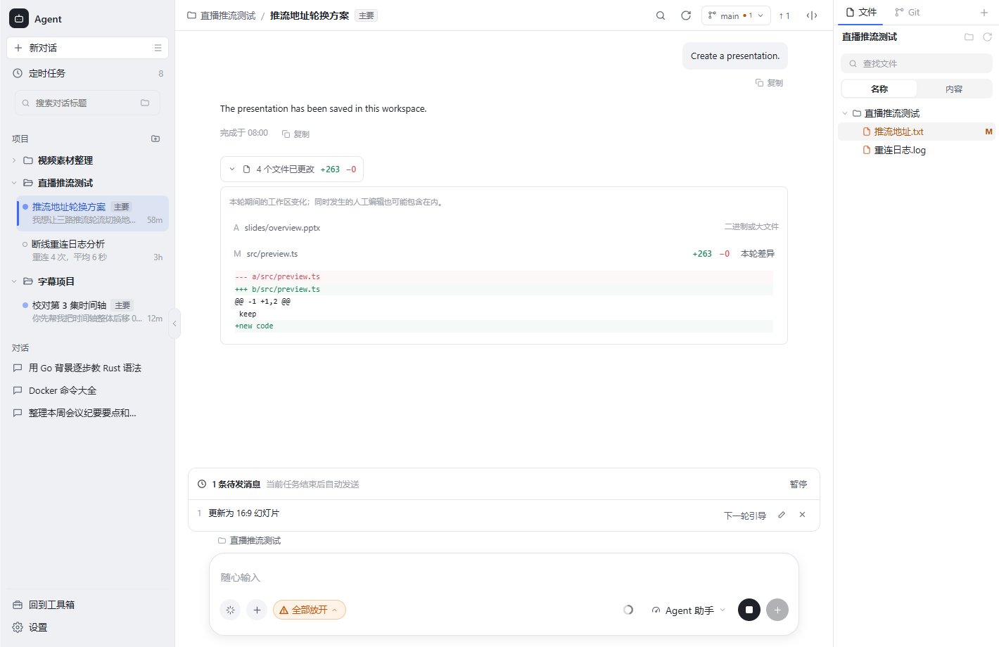
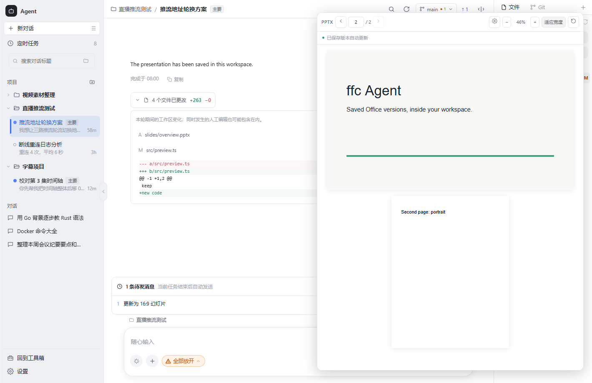

# Agent 工作区改造：预览、产物与连续对话

更新：2026-10-15。本文先记录代码审查结果，再作为本轮实现与验收清单。保留现有 Git、共享 Skills/MCP、会话管理与 CLI 后台更新功能。

## 代码现状与缺口

| 环节 | 代码事实 | 改造目标 |
| --- | --- | --- |
| Office 预览 | `CatFileRich.vue` 的 PPTX 只提取文字；XLSX 截取 200 行、30 列；没有复用文档模块的排版引擎 | 在 Agent 中接通已有 Office/WPS/LibreOffice 转 PDF 预览；保留清楚标注的基础预览 |
| 文件变化 | `CatFilePreview.vue` 只读一次；刷新会清空画面 | 检查文件版本；外部写入后更新，保留上一份完整预览；未保存编辑不被覆盖 |
| CLI 打开文件 | CLI 与前端没有共同的打开入口 | 提供每轮受限的本机文件打开桥，给 CLI 明确调用方法；文件树和改动列表复用同一入口 |
| 任务改动 | Git 面板显示整个仓库状态，消息没有每轮基线 | 记录这一轮期间的工作区文件增量，显示文件数、增加/删除行；可打开文件与本轮差异 |
| 连续输入 | `SendCatMessage` 会替换当前运行回合，输入框运行中不能发送 | 持久化等待队列，编辑、删除、暂停/恢复；成功退出后按序发送；失败/取消时保留并暂停 |
| 实时引导 | 单次 exec 适配器没有原生 steer 通道 | 能力如实显示；提供下一轮优先引导，不以停止重启冒充实时引导 |
| 办公画布 | `cat:artifact` 缺少生成端，全局 store 没有会话隔离 | 实际生成文件进入统一预览入口；仅在有效保存版本后更新，不使用模拟幻灯片冒充产物 |

## 调研与设计依据

- [Cursor Agent Review](https://cursor.com/docs/agent/agent-review)：从对话与源码控制进入改动审查；ffc 应让任务总结直接连到文件与差异。
- [VS Code Chat sessions](https://code.visualstudio.com/docs/copilot/chat/chat-sessions)：会话与工作区关联，工作区操作需要保持当前任务上下文。
- [Claude Code 交互模式](https://code.claude.com/docs/en/interactive-mode)：运行中排队输入、取回修改、主动发送；不同发送操作可能影响当前回合，必须明确区分。
- [ONLYOFFICE 文档 API](https://api.onlyoffice.com/docs/docs-api/get-started/basic-concepts/)：完整编辑器涉及文档服务器、转换与保存回调。此次复用本地排版引擎，不引入一个必须部署的服务器。
- [LibreOffice 启动参数](https://help.libreoffice.org/latest/en-US/text/shared/guide/start_parameters.html)：后台转换可用于本地 Office 预览；不等同于 Office 实时协作编辑器。
- 本机 `codex-cli 0.162.1 queue --help` 验证存在排队命令，但它不证明当前 exec 进程存在可用的实时 steer 通道。Codex 官方页面返回 403，未把它作为已读功能依据。

## 本轮实现清单

1. **应用内打开**：每轮随机凭证、127.0.0.1 桥接地址，限定会话工作区的普通文件；任务规则向 CLI 提供 PowerShell/HTTP 调用；终止后撤销。事件不会打开其他会话的文件。
2. **Office 与 PDF**：复用文档服务高保真预览、真实页面比例、页码与缩放；失败可重试，缺组件明确说明；DOCX/XLSX/PPTX 基础预览保留并标明限制。
3. **保存后更新**：轻量版本检查，稳定版本再刷新；写入中的 ZIP 等待完成；用户未保存草稿有保护；Office 转换期间保留旧 PDF。
4. **本轮改动**：独立基线，不动真实 Git index，不创建 Git 提交；受限文本记录 diff，二进制显示文件变化；按会话与 turnId 保存结果。
5. **待发消息**：每会话持久化，固定模型/权限/附件；不打断当前任务；真正退出后调度；可编辑删除、优先下一轮、暂停恢复；关闭应用后保留但不会偷偷发送。

## 验收与边界

- 任务前已有的脏文件，不应全部算成本轮改动；新增、删除、修改、二进制都能解释。并发人工或其他会话写入只能记为“本轮期间的工作区变化”，无法绝对归因于 AI。
- 统计有文件数、大小和文本上限；忽略依赖目录、Git 内部文件和符号链接；超出范围明确显示截断，不伪造精确总数。
- Office 文件必须保存为有效完整版本才能转换。PPTX 是 ZIP，逐 token 写入不会形成可显示的幻灯片；页面提示“已保存版本自动更新”。复杂排版依赖已安装的 Office/WPS/文档组件及字体。
- 打开桥只处理受限文件预览，不劫持系统默认 Office 应用，不提供任意命令执行能力。
- 实时 steer 与自动下一轮发送是不同能力。现有 exec 适配器先实现可靠队列；原生 app-server/stream-json 的持续双向传输列为后续工作。
- 验证包括受限路径、桥凭证与生命周期、任务基线和文本行数、队列停止/失败/恢复、旧预览保护、跨会话事件隔离和前端构建。

## 后续缺口

原生实时 steer、逐工具审批、会话分叉/检查点回退、Office 单元格/幻灯片原生编辑、文档批注与演讲备注、超大文件流式编辑。它们应接真实协议/引擎，不能仅增加一个看似可用的按钮。

## 执行记录

本轮已实现以下改造：

| 项目 | 结果与入口 |
| --- | --- |
| CLI 在应用中打开 | 每轮注入可直接调用的本机 HTTP 打开入口，接受相对或工作区绝对路径；凭证、工作区边界、浏览器 Origin 和任务结束撤销均有测试。普通文件、消息附件与改动列表共用预览入口；后台其他会话的请求不会切走当前会话 |
| 自动打开办公产物 | 本轮新建的有效 PPTX、DOCX、XLSX、PDF 自动进入会话预览；也允许 CLI 显式打开已有文件 |
| Office 排版预览 | 复用文档模块的 Office/WPS/文档组件引擎。转换读取一份稳定副本，按源文件版本缓存。PDF 页面采用真实尺寸，支持页码跳转、缩放和适应宽度 |
| Office 降级与设置 | DOCX 基础分页、XLSX 行列标题与工作表切换；PPTX 无可用引擎时明确显示文字概要。预览内可打开文档组件设置并重新生成 |
| 保存后刷新 | 检查文件大小和纳秒修改时间；有效 ZIP 连续稳定后刷新。写入或转换期间保留上一份 PDF；重复刷新、旧事件、切换文件与释放预览均有生命周期保护 |
| 编辑保护 | 文本保存带版本条件；外部变化暂停自动保存并保留草稿，允许明确放弃草稿后重新加载。关闭冲突文件不会卡住，未保存内容在当前应用会话中保留 |
| 每轮改动 | 启动前捕获独立工作区基线，不修改 Git index。回复下显示文件数、增加/删除行，展开查看文件和本轮差异。新增 SQLite 任务记录表，历史只加载摘要，展开再加载补丁；删除会话会清理这些记录 |
| 等待队列 | 运行中按 Enter 或加号入队，停止按钮同时保留；每条可编辑、删除、优先作为下一轮引导，整队可暂停/恢复。成功退出后自动发送；停止、失败或应用重启后暂停并保留，模型/权限/附件使用入队时的快照 |
| 办公画布隔离 | 旧画布的 artifact 按会话保留，切换会话不会串到其他任务；移除界面里的“路线 A / IR”实现术语 |

### 记录范围

每轮最多捕获 3,000 个普通文件、32 MiB 小文件内容；文本差异限定 256 KiB/文件，最多记录 100 条文件明细、16 KiB/补丁。大文件和二进制记录文件变化，无法提供文本行数。超限、无法计算差异或扫描不完整时显示范围提示，不把遗漏的文件误报为删除。Git 仓库遵循 Git 的跟踪与忽略范围；非 Git 文件夹忽略依赖、缓存和 Git 内部目录。

原生实时引导仍属于后续协议改造。此次的“下一轮引导”只调整发送优先级，不会中断当前回合；输入框尚未入队的文字仍是草稿，不自动发送。Office 更新以完整保存版本为单位，不是逐 token 的 Office 编辑或协作。

### 验证记录

- Go 专项通过：基线排除既有脏文件、新增/修改/删除/二进制、截断保护、队列执行顺序、失败/重启保留、打开入口凭证/范围/撤销、外部修改保护、不可变 Office 副本、统计历史与删除级联。相关工作区、文件、预览、队列与删除回归也通过。
- `go vet` 通过相关服务与绑定包。
- Agent 自检 173 项断言通过；三语言键检查通过（1,472 个键）。
- 浏览器走查通过：待发队列操作、本轮 diff、16:9 与竖版混合 PDF、写入中保留预览、生成完成更新、预览释放，以及真实 DOCX 文件和 XLSX 工作表切换。Office 排版引擎复用现有实现；浏览器验证使用受控预览响应，没有调用付费 AI 模型。
- 完整相关 Go 包测试仍有现有 Windows 路径、CLI 安装环境及 PDF/font fixture 失败（例如 `TestBranchRepoKeyWindows`、`TestCreateCatProjectValidationAndDedup`、`TestSendWhenNotReady`、`TestEmbeddedFontSHA256MatchesReadme` 和旧加密 PDF fixture）。未把完整测试描述为全绿。环境未启用 CGO，未完成 race 检测。

界面走查图：

