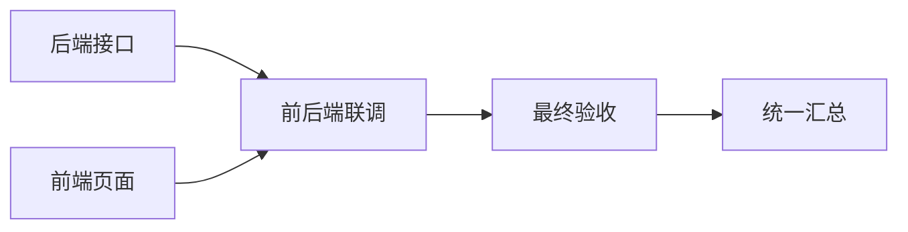

# 项目群聊的开发协作

## 使用方式

打开群聊的自动派活，直接发送开发需求。协调器使用本群排第一位员工配置的 CLI 和模型，返回任务及依赖；不固定依赖 Grok。问候、自我介绍和一般解释保持普通群聊。

开发任务按依赖推进，例如：



一项完成后，只启动前置任务全部完成的后续项。某项失败时，独立任务仍可继续，依赖它的任务等待。同一员工一次只执行一个任务，其余进入 FIFO。

默认只显示一行处理、联调或验收进度，点击“查看分工”可展开负责人、任务状态及重试、换人、停止操作。遇到需要澄清的任务，先在群里补充要求，再点击对应任务的重试；重试会带入最新群聊。也可在该项选择换人，调度器只改派指定任务，并等待旧执行退出。整项停止后可通过重试继续，已经完成的结果保留。验收完成后收起进度，只保留简洁的最终交付；内部状态块、路由 JSON、耗时和 token 统计不出现在默认消息中，执行过程可按需打开。

用户明确 @ 员工时仍直接交给指定员工，沿用原有汇报和转交流程；关闭自动派活时交给第一位员工。这两条路径不创建自动开发计划。当前没有通过一条模糊的“继续”自动猜测恢复哪项阻塞任务。

输入框支持选择图片、粘贴截图和拖入图片，发送前可预览、移除，也可仅发送图片。支持 PNG、JPEG、GIF、WebP，每次最多 20 张，每张最多 15 MB。发送失败会保留文字、提及和图片；不同群的草稿分开保存，异步上传和发送不会串群。

消息使用聊天气泡：员工头像与彩色名称位于左侧，自己的消息靠右，同一员工五分钟内的连续回复共用名称。消息时间悬停查看，执行过程按钮在鼠标悬停或键盘聚焦时显示。发送新消息会回到底部；停留在最新位置时，回复内容或布局高度变化会继续跟随；手动上翻阅读历史时不强制下翻。`node frontend/scripts/check-group-scroll.cjs` 覆盖发送、等长快照、内容增长、窗口变化、历史阅读及气泡分组和明暗主题。

发送前检查图片格式并复制到应用数据目录 `cat-group-media/<groupId>/`，迁移 0021 在群消息中保存图片名称及托管路径。协调器和各任务收到相同的原生图片附件，依赖执行、重试、改派继续读取原始需求图片。删除原始本机文件不会破坏已发消息或后续验收。Codex exec 与 resume 使用 `--image` 并通过 `--` 分隔位置参数；Claude 通过 stdin stream-json 图片块传输，避免图片经过 Windows 命令行。能否识别图片仍取决于所选模型的视觉能力。

## 项目与权限

员工属于群，群属于项目。每位员工有独立的原生 CLI 会话，以本项目目录执行。群执行员工默认使用各 CLI 支持的最高批准模式：Grok 全部批准、Claude bypassPermissions、Codex bypass。规划和职责生成保持受限的结构化调用，普通单聊的默认配置独立。

同项目员工共享实际文件目录，没有独立 worktree，也没有操作系统级目录隔离。规划器要求修改相同文件的任务串行，但这是规划约束，不是文件锁；不同群、不同计划以及单聊同时修改相同文件仍可能冲突。职责越界提示也不能替代文件隔离。最高批准模式允许的具体操作仍取决于 CLI、账户和系统权限。

## 完成与返工

计划最多 12 项，启动前检查负责人、唯一任务编号、依赖存在性、无环，以及唯一最终验收是否直接或间接等待全部任务。不合法的计划不会启动员工。

员工最终回复携带内部状态块，群聊正文会隐藏此块：

```text
<cat_task_result>{"status":"done","summary":"本项结果","evidence":"实际检查及结果"}</cat_task_result>
```

状态允许 done、blocked、failed。缺少明确状态时按 blocked 处理，进程退出成功不等于任务完成。最终验收还必须提供 evidence，且该轮存在实际工具调用记录，否则不能标记整项通过。系统无法仅凭这些记录保证测试覆盖充分或模型描述完全准确，仍应检查具体验证结果。

验收明确发现问题时，可以返回 failed，并增加 `rework:["前置任务编号"]`。调度器只重置这些前置项及其后续依赖，把验收意见带给返工员工，保留无关成果，最多自动返工两轮。仍然失败或无法定位时保留未完成状态，等待用户补充、重试或改派。

## 状态保存与中断

SQLite migration 0020 保存原始需求、任务依赖、负责人、尝试次数、结果、证据、执行编号与状态版本。界面按版本合并快照和事件，迟到事件不能覆盖新状态。执行编号防止改派前的旧结果覆盖新执行。

停止会先保存状态，再取消进程并清队列，迟到结果不能重新启动已停止任务。重启后已完成成果仍保留，原来运行或排队的任务变为“应用中断，结果尚未确认”；用户检查后可重试，避免直接重放可能已经写入的操作。内存队列由持久化依赖图在重试时重建。

群聊保留所有活跃协作和最近十项终态协作。删除群聊会级联删除协作记录。

## 验证范围

服务测试用临时项目、SQLite 和可控适配器覆盖并行分工、依赖等待、失败重试、三类 CLI 的项目目录与权限、验收证据、返工上限、任务改派、迟到结果、停止和中断恢复；存储测试覆盖升级、重新打开数据库及删除级联。图片测试覆盖仅发图片、显式提及、自动派活、关闭派活、图片校验、托管副本及后续任务读取；CLI 进程回归检查 Codex 新会话及续聊参数，以及 Claude 普通、结构化和流式输入的原生图片块。

另有可选真实 CLI 验收：`FFC_GROUP_LIVE_QA=1 go test ./internal/service/cat -run 'TestGroup(Workflow|Images)_LiveCodex' -v -count=1 -timeout 9m`。全部使用独立临时项目及数据库，不会向用户的真实群发送消息或在本项目中让员工执行测试开发。

2026-10-18 验证记录：

- 群聊、路由、结构化输出、群聊存储与迁移相关 Go 回归通过。
- Vue 类型检查、Vite 生产构建和三语言文案检查通过。
- 本机真实 Codex `gpt-6.1-sol` 接受嵌套任务 schema，29.144 秒返回“前后端并行 → 联调 → 验收”的有效计划。
- 真实 Codex 员工在临时项目完成后端、前端并行开发，等待依赖后执行实际 Node 联调测试，最终统一汇总；独立重跑 2 项测试通过。同一测试随后发送无 @ 的“你们介绍下自己”，三名员工均回复；合计 163.49 秒。
- 真实 Codex 图片验收用无 @ 群消息发送红蓝图片，协调器和员工都收到原生附件，员工正确答出“左侧是红色，右侧是蓝色”，53.61 秒通过。
- `node frontend/scripts/check-group-chat.cjs` 在真实 Vue 组件上验证简洁进度、精确任务重试/改派、停止、成员设置、过程抽屉、1024/1440 布局、最终交付、键盘提及、图片选择/上传/粘贴/拖入/预览/移除、仅发图片及失败草稿恢复。
- 开发程序已于 18:17 重建并重载，实际数据库迁移至 21，协作表和群消息图片列均已存在。
- 三个相关 Go 包的全量测试未通过：服务包的 Windows 路径及分支收藏测试失败，Git 测试达到 90 秒包级超时；CLI 包出现本机已安装 CLI 与缺失检测预期不符、历史读取和检测时序失败；存储包的 `TestMigration0005AndBackfill`、`TestBackfillBatches`、`TestTaskOutputsInDir` 失败。此次未扩展修改这些模块，不能将相关功能回归通过视作仓库全量测试通过。
