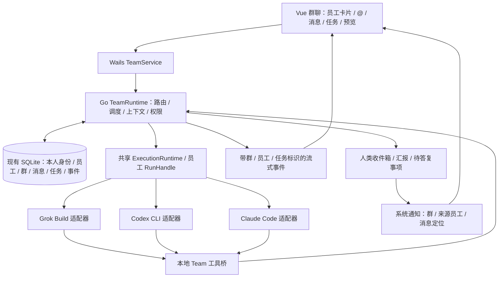

# FFC 数字员工与协作群设计方案

调研日期：2026-10-16。本文保留完整设计目标；首版群聊运行时已接入，已实现范围、实际测试与保留限制见 [实现与验收记录](digital-employee-group-implementation.md)。

审核更新：2026-10-16，方案 v0.2。已对照本地代码与已安装 CLI 的版本、帮助和本地使用文档进行静态可行性审核；未向模型发送实际任务，也未完成三家实时输入的端到端验证。结论：群聊、身份、@ 投递、上下文与通知具备实现基础；三家实时干预和同引擎不同配置并发需要先完成第 16、20 节的技术验证，不能将文档审核通过等同于功能已经可用。已明确的异常处理与扩展约束见第 17–19 节。

实施更新：2026-10-16。下文的审核描述记录实施前结论。现已实现身份、群聊、真实工具委派、持久化等待、原文上下文、人类问答、通知接口与 Office 实时预览；真实安装的三家 CLI 已通过隔离本地模拟 API 与应用 MCP 调用验证。Codex app-server 提供 active-turn steer；Claude 标为 checkpoint，Grok 标为 next-turn。同一物理工作目录采用串行保护，未启用自动 worktree。第 20.3 节按实际证据更新，未关闭项目继续保留。

## 1. 产品定位与推荐结论

目标是用户拥有一组可定义身份、专业和工作要求的数字员工，把员工拉进项目群后，既可以自己 @ 员工派活，也可以让员工主动 @ 同事请教、委派、交接和复核。所有公开回复、任务进度和产物都留在群里。

用户本人也是具有稳定身份的人类群成员，员工可以 @ 用户汇报、提问和请求决策。所有员工都必须知道当前群的完整成员名册，包括用户本人和其他员工；员工 @ 用户的消息需要触发系统通知。

**员工是产品中的主体，CLI 是员工的执行引擎。** 例如：

| 员工 | 用户设定的岗位 | 工作要求举例 | 可选执行引擎 |
| --- | --- | --- | --- |
| 小周 | 产品经理 | 先明确需求和验收标准，重视用户操作成本 | Grok Build |
| 小林 | 前端工程师 | 注重交互、视觉一致性和组件复用 | Codex CLI |
| 小陈 | 后端工程师 | 注重数据一致性、并发和错误处理 | Codex CLI 或 Claude Code |
| 小许 | 测试工程师 | 依据实际运行结果验收，报告复现步骤 | Claude Code |

这些分工由用户配置，不把某个模型的能力硬编码为岗位。一个 CLI 可以支持多个员工；同一个员工也可以更换引擎，保留应用侧身份、职责和已记录的知识，但不能直接继承另一种 CLI 的原生会话。

采用现有 Go + Wails + Vue + SQLite，新增应用内 TeamRuntime，继续调用现有 CLI 适配器。身份、群消息、@ 路由、持久化任务和工作区隔离由应用负责，任务理解、执行和协作判断由各员工的 CLI 负责，无需引入外部编排框架。

员工根据当前任务自主决定是否向同事请教、委派或请求复核。岗位配置描述职责、专长与交付标准，不预设员工的出场顺序或任务必须经过哪些岗位；用户可以随时 @ 任意员工介入。

不需要新增模型 API Key，也不需要另开一个模型充当必选的群管理员。确定性路由器负责投递；如果用户希望有主管，可把某位员工设为协调人，由该员工使用自己的 CLI 做业务判断。

## 2. 已有代码能够复用什么

- `internal/catagent/registry.go` 已有统一 `Adapter.RunTurn` 和三家适配器注册机制。
- `internal/catagent/build_adapter.go` 的 `TurnOptions` 已能传原生会话、项目目录、规则、文件、Provider、临时工具环境和流式回调。
- `internal/service/cat/service.go` 已有轮次生命周期、停止、流式消息和工具活动。但当前一条 `CatConversation` 固定一个 `AgentKind`，且同一会话只允许运行一个轮次。
- 当前单聊正文主要从对应 CLI 的原生历史加载，不能把三家的导出记录拼起来就当作可靠的群历史。
- `workflow_queue.go` 已有单会话排队、草稿和部分即时引导能力；群聊需要在其上增加按员工分开的队列、任务依赖与当前任务实时干预。现有 Codex app-server 路径通过 `turn/steer` 追加输入，但启用自定义 Provider 时，`cli_agent.go` 当前会绕过该路径走 exec；Claude 与 Grok 的现有适配器尚未接入运行中输入。
- 已有共享 Skill / MCP、临时 loopback 文件与 Office 工具桥、Git 操作、改动统计和文件预览，可以逐步扩展到群任务。
- `app_cat_schedule.go` 已封装 Wails 系统通知发送与点击回调，`internal/service/cat/notify.go` 已有可用性与授权检查。可复用平台通知基础能力，但群 @ 通知需独立配置和路由；现有普通任务通知会在窗口聚焦时被抑制，不能直接照搬。

必须新增的是群领域模型和调度服务。不要把单聊的 `agentKind` 改成数组，也不要让三个 CLI 争用同一个原生 session ID。

## 3. 调研与技术选型

以下结论基于调研时实际读取的项目 README、接口源码或许可证，不代表已完成这些框架与本项目的实机集成。

选型结论是复用现有 CLI，在应用中实现群消息和任务路由。下表保留调研对比作为决策依据，其中框架均不作为本方案的依赖或后续接入计划。

| 方案 | 对本需求的价值 | 当前集成成本与判断 |
| --- | --- | --- |
| [Eino](https://github.com/cloudwego/eino) | Go 原生，提供自定义 Agent 接口、流式处理、顺序/并行/循环工作流及中断恢复 | 仍需包装 CLI Runner，并自行实现群聊、身份、原生 CLI 会话和 SQLite 业务表；本需求通过现有 CLI 与应用路由即可实现，不引入 |
| [LangGraph](https://github.com/langchain-ai/langgraph) / [LangGraph.js](https://github.com/langchain-ai/langgraphjs) | 状态图、持久化、人工介入，适合复杂协作流程 | 可以包装 CLI，但需要 Python 或 Node 编排服务及与 Go 的进程间通信；当前无需为三家 CLI 增加一套后台运行时 |
| [AG2](https://github.com/ag2ai/ag2) | 多 Agent 对话、路由和协作模式参考价值高 | Python 栈；当前 README 明确区分新版协议化 Network 与 Classic 的 GroupChat，选用前必须固定具体产品线和版本 |
| [Microsoft Agent Framework](https://github.com/microsoft/agent-framework) / [Go SDK](https://github.com/microsoft/agent-framework-go) | 多 Agent、群协作、工作流和检查点 | Go 版 README 标注 public preview，且列有尚未实现的能力；本方案不引入 |
| [AutoGen](https://github.com/microsoft/autogen) | 经典群聊和发言选择设计可参考 | 调研时 README 已标注维护模式，并建议新项目选择 Microsoft Agent Framework，不建议新接入旧 AutoGen 栈 |
| [Google ADK Go](https://github.com/google/adk-go) | Go 原生 Agent 和多 Agent 组合 | 仍需定制 CLI 包装；调研时 main 分支 go.mod 要求 Go 1.26.6，本项目声明 Go 1.25.0，不能不经验证直接接 main |
| [CrewAI](https://github.com/crewAIInc/crewAI) | 岗位、目标、团队、任务和委派很贴近数字员工概念 | 主要是 Python Agent 应用框架。产品模型值得参考，但现有 CLI 的登录、续聊、流式输出仍需自己适配 |
| [MCP Agent Mail](https://github.com/Dicklesworthstone/mcp_agent_mail_rust) | 持久身份、异步收件箱、线程和文件预约，贴近跨 CLI 员工通信 | 原 Python 版 README 已转向 Rust 版；Rust README 的安装说明面向 Linux/macOS，原生 Windows 需另外验证；许可证含附加限制，不作为直接引入依赖，方案仅参考公开的消息/邮箱概念 |
| [Claude Squad](https://github.com/smtg-ai/claude-squad) | 多 CLI 在隔离 Git 工作区中并行执行，可参考任务与改动管理 | 是终端产品，依赖 tmux 等环境；适合参考隔离方式，不适合直接嵌入当前 Windows 群聊界面 |

协议也要分清：

- **MCP** 用于向 CLI 提供 `team_delegate` 等应用工具。MCP 本身不会自动让另一位员工开始工作。
- **Agent Client Protocol（ACP）** 用于编辑器与 coding agent 通信，不能等同于群聊调度。它也不同于历史上的 Agent Communication Protocol。
- **A2A** 面向独立 Agent 服务之间的互操作，可作为将来跨电脑、跨服务接入的协议；当前本地三家 CLI 不需要先全部改成 A2A 服务。

参考：[Agent Client Protocol](https://github.com/agentclientprotocol/agent-client-protocol)、[A2A](https://github.com/a2aproject/A2A)。

## 4. 用户身份、员工档案、群成员和会话必须分开

### 用户本人身份 HumanProfile

首次使用时自动创建并持久化本人档案，包含稳定的 humanId、显示名字、头像、默认身份说明和通知偏好；可以在设置里修改。默认群内身份为“负责人”，用户可改为“老板”“产品负责人”等称呼，不需要额外注册云端账号，也不要求每次建群重新填写。

建群时自动把本人加入为人类成员并设为群主。本人档案可以跨群复用，每个群可设置不同别名或职责；界面中自己的成员卡可显示“我”，传给员工的名册则使用明确名字和真实 memberId，避免每个员工都把“我”理解为自己。

人类身份和员工身份分别管理。人类成员没有 CLI、原生 session 或 worker 执行槽；员工 @ 用户时进入人的收件箱、汇报和待答复流程，不启动 CLI。后台根据真实本地用户会话识别本人，不能通过消息正文或显示名字冒充人类成员；群主权限由后端成员关系决定。

### 员工档案 Employee

长期保存：名字、头像、岗位、职责、专长、关注点、交付标准、工作风格、CLI 类型、模型、推理档位、可用技能和工具、允许的项目范围、并发上限。

岗位要求应写成可检查的标准，例如“修改界面后检查窄窗口”“数据库变更必须说明迁移方式”“验收报告写明测试是否实际执行”，不要只写“你是优秀工程师”。

岗位描述影响模型行为，权限必须由后端和 CLI/操作系统能力执行。身份为“管理员”不会自动获得全部文件或命令权限。

### 群成员 RoomMember

关联人类或员工档案与项目群，保存本群别名、临时职责覆盖、可委派范围、入群时间和启停状态。使用 `memberType=human|agent` 区分成员类型，对应 `humanId` 或 `employeeId`，两种身份关联必须互斥。员工的实际有效权限取用户授权、员工权限和群权限的交集。

允许同一引擎的多个员工共存。人类与员工统一使用群内唯一 memberId 进行 @ 和路由，显示名称仅用于展示，重名、改名不会把任务或通知发错人。成员名单始终包含本人，并标注人类/员工、群主/协调人、岗位和状态。

### 原生会话 WorkerSession

至少按 `员工 + 群 + 工作区代次 + 执行配置代次` 隔离原生 CLI 会话；跨群不复用同一会话。更换 CLI、隔离工作区或不兼容的 Provider/权限配置后建立新的原生会话，通过应用侧任务摘要衔接。独立任务默认使用独立任务会话；明确延续同一任务时才复用原会话，避免同一员工在群内交替处理无关事项而混淆上下文。

员工的长期知识不等于 CLI 的历史文件。应用保存已确认的工作规范、项目事实和验收经验，带来源、适用项目、更新时间和版本；群聊天不能自动成为所有群共享的长期记忆。

第一版可以先提供用户可编辑的员工知识笔记，后续再加可审阅的记忆候选，避免承诺模型会自动永久记住所有内容。

## 5. 使用体验

1. 新建员工：选择引擎，填写名字、岗位、专长、关注点、工作要求和权限。
2. 新建协作群：选择项目和员工，自动加入本人身份，配置是否允许主动请教、委派和自动交接。
3. 群输入框输入 `@`，展示全部人类和员工成员、岗位、在线/缺失/忙碌状态；支持一次 @ 多人。
4. 每位员工的回复有自己的头像、身份和任务关联；多个员工同时输出时，各自更新自己的消息气泡。
5. 群侧栏显示成员和任务，任务下可查看负责人、依赖、改动文件、运行日志和产物。
6. 能停止某位员工、取消单个任务、暂停整个群的自动委派；不会为了停止一位员工把所有 CLI 一起终止。
7. 员工运行中，用户仍可 @ 它补充或纠正当前任务。输入框区分“干预当前任务”和“安排新任务”，前者优先投递至当前轮次，后者可排队；群中显示真实的投递与接收状态。
8. 员工可以 @ 本人汇报进展、提交结果、提出问题或请求决策。本人收到系统通知，群列表和“@ 我的”收件箱显示未读；点击通知打开正确的群并定位到原消息。
9. 用户可引用员工的汇报或问题直接回复，或 @ 指定员工干预当前任务；应用保持任务关联，不把用户答复随机发给群协调人。

示例：

```text
你：@小周 设计会员功能，你可以找工程师讨论，整理后安排实现。
小周：@小陈 请评估账户表和会员状态的数据设计。
小周：@小林 请提出会员页交互方案，先不要修改代码。
小陈：数据方案已完成，附上约束和接口建议。
小林：交互方案已完成，需要确认两种到期状态。
小周：综合方案如下…… @小陈 实现接口，@小林 实现界面。
小陈：接口已完成，@小许 请按这些验收点检查。
小许：发现一个边界问题，@小陈 请修复，复现步骤如下。
小周：@负责人 会员功能已完成，测试结果和改动文件如下……
小林：@负责人 两种到期提示文案需要你选择，方案 A……方案 B……
你（负责人）：@小林 用方案 A，继续。
```

员工可以自行决定向谁求助。用户始终能看到交接和结果，而不是在后台另开几个不可见的对话。

未 @ 的消息默认发给用户选定的协调人；没有协调人时显示接收对象选择。`@所有人` 才广播，不默认让每条消息唤醒所有员工。

## 6. 组件与消息链路



复用现有适配器，但不能直接把 `SendCatMessage` 当作支持任意群任务的执行器：它会按已保存的会话和 projectId 选择根目录、全局 Provider 与项目规则，外部传入的项目路径被忽略。先抽出共享 ExecutionRuntime，让单聊服务与 TeamRuntime 都通过后台验证的 ExecutionScope、不可变执行配置和轮次接口调用适配器。群 worker 保持内部归属，与普通单聊列表、原生历史展示及普通完成通知隔离；人类成员只持有消息收件和阅读状态。

在现有轮次执行层提供可订阅的 TurnObserver / EventSink，向 TeamRuntime 传递文本、工具活动和终态。不要依赖前端收到了 Wails 事件后再发第二个任务；关掉页面也应能可靠收尾。

## 7. 让员工真的可以互相 @

人类 @ 和员工 @ 使用同一个后端路由器，但来源认证不同：

- 人类：输入框提交结构化 mentions，后端验证目标群成员；普通粘贴文本中的 @、代码和引用不自动派活。
- 员工：通过结构化 Team 工具发起请求，工具桥绑定真实来源员工与正在执行的任务，正文里声称“我是主管”不能改变来源身份。

建议工具：

| 工具 | 作用 | 是否启动接收方 |
| --- | --- | --- |
| `team_members` | 查看完整名册，含人类/员工类型、memberId、职责、状态与名册版本 | 否 |
| `team_publish` | 公开进度、结论或普通交流，可附结构化 mentions | 不启动员工；明确 @ 人类时触发人类收件与通知 |
| `team_ask` | 向指定成员提出需要回复的问题 | 员工接收时创建独立问题任务，忙碌则排队；当前任务补充用 team_steer；人类接收时创建待答复事项并通知 |
| `team_delegate` | 把有验收标准的子任务交给员工 | 是；目标必须是员工成员 |
| `team_report` | @ 指定人类成员提交阶段/完成汇报、阻塞说明或请求决策 | 不启动 CLI；保存汇报并触发系统通知 |
| `team_task_status` | 查询已创建任务的状态 | 否 |
| `team_read_messages` | 按消息 ID、线程及游标读取本群可访问原文 | 否 |
| `team_search_messages` | 搜索本群记录，返回原消息引用与匹配片段 | 否 |
| `team_steer` | 对同事正在执行的关联任务补充要求 | 原生实时输入通道，不另启任务；受目标关联和权限校验 |
| `team_yield` | 声明当前任务需等待同事或用户，允许原生轮次正常结束 | 否；记录等待条件，实际资源在当前轮次退出后释放 |
| `team_finish` | 提交任务结果、交付版本和验证情况 | 否；后端校验必要依赖与当前需求版本后确定逻辑任务终态 |

例如，产品经理调用：

```json
{
  "tool": "team_delegate",
  "requestId": "本轮唯一请求 ID",
  "toMemberId": "backend-member-id",
  "title": "实现会员状态接口",
  "instruction": "按照已确认的数据方案实现接口。",
  "acceptance": ["处理已过期会员", "提供接口测试结果"],
  "dependsOn": ["data-design-task-id"],
  "artifactIds": ["confirmed-api-design-id"]
}
```

后端从能力凭证确定 `roomId/fromMemberId/parentTaskId`，不信任调用者自行指定身份。接受请求时，在同一事务里保存公开交接消息、子任务与待投递记录，再返回 task ID；群中显示自然语言的“@小陈 实现会员状态接口”，不把这段 JSON 拼进消息正文。

接收方完成后，运行时自动发布带任务关联的结果并通知委派者的收件箱。需要继续整合时，再恢复委派者的下一轮。工具立即返回已受理，不能阻塞占用父员工的执行槽等待子员工，否则相互请教可能死锁。`requiredForCompletion` 明确子任务是否阻塞父任务；等待通过 `team_yield` 记录，父员工正常结束当前原生轮次后释放执行槽与共享写入租约，原生轮次结束不等于父任务完成。等待、唤醒及写入锁重获规则见第 18 节。

### 员工 @ 用户：汇报与待答复

每个用户发起的根任务保存 `requesterMemberId` 和 `reportToMemberId`，默认汇报给发起任务的本人。员工可以从名册确认用户身份，通过 `team_report` 向其汇报，或者通过 `team_ask` 请用户回答问题。普通阶段进度可由员工选择时机汇报，根任务完成、失败或取消时必须形成可追溯的结果汇报；应用在逻辑任务终态核查并补发缺失通知，不依赖模型永远记得 @ 人。同一结果汇报不重复生成；原生进程退出不能单独触发“整个任务已完成”。

例如：

```json
{
  "tool": "team_report",
  "requestId": "本轮唯一请求 ID",
  "toMemberId": "owner-human-member-id",
  "category": "completed",
  "content": "会员功能已完成，包含演示接口与深色页面，测试结果见附件。",
  "artifactIds": ["delivery-artifact-id"]
}
```

来源员工、所属群与当前任务由工具凭证确定；后端验证接收者为本群仍有效的人类成员。群中渲染为“@负责人 会员功能已完成……”，保留改动、验收结果与产物引用，不展示工具 JSON。

`category=completed` 作为完成汇报候选，与本任务的 `team_finish` 及原生轮次收尾校验合并处理；尚未达到逻辑任务完成条件时不提前发布为“已完成”或发送完成弹窗。可先发布真实阶段进度；最终状态改变时沿同一关联结果记录更新，避免同一任务的完成汇报与兜底通知重复。

汇报分为进展、完成、阻塞、问题与决策请求。普通汇报不让任务进入等待；明确需要用户答复时，持久化待答复事项，并让受影响的任务进入 `waiting_user`，其他员工可继续独立工作。工具受理后立即返回，不占用 CLI 执行槽等待人回复。

用户引用消息回复或处理待答复事项后，应用关联原问题与任务，按当前执行能力实时投递或恢复下一轮。未显式 @ 的回复只有在输入框已经显示其引用问题与任务时才定向关联；不能仅因群里恰好只有一个未答问题就把任意新消息当作答复。存在多个候选时让用户选择。已读、已答复与已解决分别记录；看到通知不代表用户确认了某项决策。

### @ 本人的系统通知

1. 后端在接受已认证、带结构化人类 mention 的公开消息时，同一事务保存消息、人类收件项和通知 outbox。普通文本里出现 `@负责人`、代码引用或流式正文片段不会反复触发通知；`team_report`、`team_ask` 等入口共用这一规则。
2. 群 @ 通知使用独立的“有人 @ 我”开关，默认开启；在前台、后台、最小化和托盘运行时均提交系统通知请求，不复用普通任务通知的前台抑制条件。关闭普通任务完成通知不关闭 @ 通知。
3. 通知显示群名、来源员工、汇报/待答复类型及简短内容，例如“会员项目群 · 小林 @ 你：需要确认到期提示文案”。通知载荷保存 `roomId/messageId/taskId/recipientMemberId`；点击后恢复窗口、打开群并定位高亮原消息，需要答复时展示原问题。通知正文预览可由用户关闭。
4. 同一公开消息对同一接收者只创建一个通知项，并在系统通知通道可用时使用稳定通知 ID；流式更新、事件重连和任务完成回调不生成重复弹窗。短时间多条独立 @ 可合并显示数量，保留每条收件记录；通知提交结果未知时避免盲目重试导致重复提示。
5. 群列表的 @ 未读数、“@ 我的”收件箱与待答复列表持久化，用户打开原消息后才按阅读规则消除未读，关闭系统弹窗不等于已读或已解决。用户未回复时保留待答复状态，不自动做出决定。
6. 复用 `app_cat_schedule.go` 的系统通知平台能力，扩展点击路由以支持群和消息，不能只传单聊 convId。不可用、未授权、发送失败或系统免打扰时，应用保留未读与待答复入口，显示可确认的通知状态；系统是否实际弹出横幅受操作系统设置控制，不能把“已提交”宣称为“用户已看到”。
7. 本地应用彻底退出时，CLI worker 与本地服务不再运行，不能承诺持续通知。重启后恢复未读与待答复事项并显示未读汇总，不把过去的所有消息重新逐条弹出。

## 8. MCP、Skill 和脚本如何配合

TeamRuntime 是实际投递服务；MCP、Skill 和脚本只是 CLI 调用它的入口。

1. 优先通过各 CLI 已验证支持的 MCP 传输暴露 Team 工具；MCP 配置与授权按本群运行实例隔离。
2. 未能可靠接入 MCP 时，用应用提供的 Node 脚本包装相同工具协议，借助现有 ToolEnv 注入临时端点和凭证。
3. 配套 Team Skill 说明如何读取完整名册、区分人类与员工、识别同事职责、何时请教、如何描述验收标准和引用产物，以及如何 @ 用户汇报或请求决策。
4. 群能力凭证只允许访问当前群、员工和任务，监听 loopback；不把凭证写进群消息、项目 Skill 或用户的永久共享配置。

只写 Skill 提示词不足以完成群协作，必须有后端服务负责创建和执行另一位员工的任务。

现有共享 Provider/MCP 配置存在并发写入及读取时机问题。复用适配器前，应把执行参数做成每轮不可变快照，优先使用进程参数、进程环境和原生支持的私有配置注入；只在准备阶段加锁不能保证运行中的 CLI 不重新读取配置。对必须共享磁盘配置且无法验证配置隔离的场景，使用全生命周期兼容租约，只让相同配置指纹的进程并发，并清楚展示被阻塞原因，不在运行中的员工之间反复改同一份全局配置。

## 9. 上下文与长期记忆

每次任务带入：员工岗位与交付标准、当前群完整成员名册、当前用户目标、明确的任务指令、相关线程原文或已有摘要、尚未送达的公开消息、依赖任务结果，以及有权限访问的产物引用。初版由代码取记录、按格式组装后提交 CLI，不要求额外调用 AI 先整理；较长历史的摘要可后续增加，不成为投递任务的前置依赖。

### 全体员工对群成员的认知

应用持有权威名册，每次启动或续接员工都注入当前全部有效成员的精简记录：`memberId`、类型、人类/员工显示名、群内身份、职责、专长与关注点、成员/执行状态，以及 `rosterVersion`。同时提供 `selfMemberId`、群主 memberId、当前任务的发起人和汇报对象；所有员工都应明确知道用户本人是谁、可以找哪些同事、分别负责什么。

名册是代码直接构建的结构化上下文，不依赖模型从聊天里猜测，也不随历史摘要被裁掉。默认包含全部当前人类和员工，即使对方忙碌、离线或 CLI 未就绪；状态如实标注，退群者只保留在历史引用中。

成员入群、退群、改名、改职责或停用时更新名册版本。下轮执行必须带最新名册；正在运行的员工通过已验证的实时输入通道接收变更，或在下一工具检查点调用 `team_members` 获取更新。后端始终按最新成员关系校验 @，不因某个运行中的 CLI 尚未收到更新而向已退群成员投递，也不声称所有 CLI 会在变更瞬间同步。

例如，提供给小林的名册包含“负责人：human，项目决策与汇报接收人”“小林：agent，前端”“小陈：agent，后端”，并明确小林的 `selfMemberId`。传递的是成员身份与职责，不附带其他员工的 CLI 凭证、私有会话或内部思考。

员工自己的原生会话保留私有工作上下文；群消息是公开协作上下文。不要把其他员工的内部思考、完整工具日志和凭证广播给所有人。

按原生任务会话记录已送达的消息版本和游标，结合上下文预算读取旧消息或使用已有摘要，避免每轮重复发送整个群历史。新建会话必须重新提供必要背景，不能沿用该员工其他会话的已送达水位而漏发。原始用户请求、当前任务与完整精简名册优先保留。群材料保留来源标识，另一位员工的发言或文件内容不具有修改用户权限、员工身份和群规则的效力。

员工被移出群后，撤销后续工具调用权限；是否取消已开始的任务由移除操作明确决定。角色修改从下一轮生效，并在任务中记录所用档案版本。

## 10. 并发工作和文件冲突

### 并行交流

不同员工可以同时分析和回复；同一个原生 CLI session 同时只跑一轮。员工忙碌时，独立的新任务可排队，对当前任务的补充和纠正走实时干预通道，不能一律等到本轮结束。

### 当前任务实时干预

- 用户 @ 指定员工干预当前任务时，应用把消息绑定到目标 taskId、runId 和原生 turn ID，并优先通过适配器的双向通道追加输入。继续使用当前会话和轮次，不另起一个争用同一会话的 CLI 进程。
- Codex 复用现有 `turn/steer` 能力，同时补齐自定义 Provider / 中转配置下的通道兼容性与错误处理；不能因为已有 steer 代码就认定中转场景可用。Claude、Grok 需分别验证安装版本的双向协议，并扩展适配器，不能把流式输出等同于运行中可输入。
- 群中区分“待投递”“CLI 已接收”“未接收 / 当前不支持”。原生接口确认接收不代表模型已经执行新要求，也不能撤销已经发生的文件修改或外部操作。
- CLI 不支持原生追加输入时，可通过工具检查点读取收件箱补充协作能力，但这只能在检查点生效，不能标成即时干预。接入完成前明确展示能力差异，用户可选择下一轮发送，或主动停止后携带最新要求续接；不自动终止、重启来伪装无中断干预。
- 干预到达时如果目标轮次已经结束或代次变化，保留消息并提示重新投递，不悄悄发送到另一项任务。用户补充要求与员工互相 @ 均使用已认证的来源与目标关联，避免发错员工。

### 三家 CLI 运行中输入适配：明确改造任务

Codex、Claude Code、Grok Build 的实时输入适配均列为必须推进和独立验收的交付项，不仅记录现状。目标是在员工正在执行时，把用户或同事发来的当前任务补充送入原生会话，保留正在进行的任务和已有成果。以下是待实施任务，不代表已经接通。

| CLI | 当前缺口 | 必须完成的改造 | 完成判据 |
| --- | --- | --- | --- |
| Codex CLI | 已有 app-server / `turn/steer`，但自定义 Provider 启用时绕过双向通道走 exec | 调整传输选择逻辑，让受支持的中转配置也能使用 app-server；保留 Provider 参数、认证、模型、推理档位、权限与会话续接；复用真实 threadId / turnId 投递干预，处理启动、认证、连接及原生拒收错误 | 普通配置与自定义中转分别实测：任务运行中接收补充要求，在原轮次调整后续执行，持续流式输出且不自动切换到 exec 重跑 |
| Claude Code | 当前采用单次提示输入与流式输出，未提供运行中追加输入 | 验证目标版本的原生双向输入协议，改造启动参数、持续 stdin 写入和事件读取；把运行中输入、原生消费时机、会话标识和错误映射接入统一能力接口；保持 Provider、规则、技能和权限行为 | 实际运行期间送入补充要求，确认 CLI 在当前任务后续处理中消费，而非只留到下一轮；不终止进程、不新开竞争会话，继续输出结果 |
| Grok Build | 当前通过提示文件发起 headless 任务，流式输出不具备应用侧实时输入接口 | 核对目标版本是否提供交互、RPC 或 ACP 等双向通道，采用经实际验证的原生方式；新增持续输入、请求关联、事件处理与会话恢复适配，保留既有中转和模型配置 | 实际运行期间接收针对当前任务的补充要求，当前任务后续执行随之调整；过程和结果回到同一员工、同一群任务，其他员工不受影响 |

具体协议字段、参数和最低 CLI 版本以实施时的官方说明、安装版本帮助及真实进程验证为准。尤其要区分“流式输出”“下一轮输入排队”和“当前任务实时输入”；不能仅凭支持 JSON 输入或 ACP 事件就宣称已支持干预。如果某个上游版本没有相应能力，记录已验证的限制、版本和解决所需条件，将该项标为未完成及受上游限制，不以检查点轮询或停止重启代替验收。

统一接入要求：

1. 在现有 `LiveSteer`、`OnSteerReady`、`SteerFunc` 和 `CanSteer` 基础上，增加可查询的实际能力与不可用原因。前端按当前执行通道判断，不按 CLI 名字硬编码为支持。
2. 用户 @ 和员工工具调用复用同一投递入口，绑定 roomId、memberId、taskId、runId 和当前原生轮次；新任务与当前任务补充分别路由。
3. 干预消息持久化并使用唯一请求 ID。原生协议支持去重时传入该 ID；不支持时，投递超时或连接断开后标为结果未知，避免盲目重发导致原生重复消费。
4. 不支持、拒收、超时、进程退出及轮次结束均保留原消息，返回具体状态；不能收到请求就直接显示“CLI 已接收”。运行中的连接失败不自动启动另一执行通道重放整个任务。
5. 保持中转请求、工具调用、文件预览、停止和已有单聊行为；敏感认证信息不得出现在群消息或运行日志中。

适配验证至少覆盖：三家 CLI 各自的普通配置及已有中转配置、用户 @ 干预、同事针对当前任务的补充、连续多条输入、工具执行期间输入、轮次刚结束时输入、拒收、断连与超时。先验证协议收发和错误路径，再以真实 CLI 任务确认补充要求实际影响后续工作，不只依赖模拟测试。

### 修改同一个代码项目

第一版提供两种执行策略：

- 共享目录：会改文件的任务串行执行。只读并发要由实际权限能力保证；仅有“请不要修改”的提示词不等于隔离，不能据此承诺并发安全。
- 并行开发：每个写代码任务使用独立 Git worktree 和分支，目录放在用户数据目录中，任务记录基线提交和产物版本。交付后通过差异审查及受控合并进入目标分支。

Git worktree 只隔离文件和 Git 工作树，不是命令执行沙箱。推送、部署和其他外部动作仍遵循用户与项目原有授权。

源工作区已有未提交修改时，不丢弃、不擅自提交；用明确的基线及补丁快照策略决定哪些修改进入任务。跨工作区复核必须明确对应提交、补丁或产物，不能让测试员工误测另一份代码。

非 Git 项目先用串行写入；如果采用副本并行，必须单独处理回写冲突。PPTX、DOCX 等二进制文档按任务副本产出，使用选定版本交付，不尝试自动文本合并同一个文件。

## 11. 调度、可靠性和停止机制

建议默认值：群并发最多 3 个 worker，每个 worker 同时 1 轮；一次用户任务最多派生 12 个子任务、委派深度 4。作为可调整的产品参数，不代表实测最优值。

每次委派记录 parentTaskId、rootTaskId、causationId。禁止任务依赖成环；限制重复交接，避免两人不断互相请教。达到边界时暂停自动派活并在群里说明原因，用户可调整后继续，不逐条弹确认。

状态分开管理，任务可以跨多轮执行，详见第 18 节：

```text
逻辑任务：queued / running / waiting_dependency / waiting_user / needs_review
          → completed / failed / cancelled
原生执行：starting → running → stopping → completed / failed / cancelled / interrupted
                         ↘ completed / failed / interrupted
```

数据库状态、任务投递和公开消息必须保持一致。请求使用幂等 ID；执行槽带租约和代次，避免旧进程迟到的结果覆盖重试后的任务。

应用重启后可恢复未开始的排队任务；已运行且结果未知的原生 run 标为 interrupted，逻辑任务进入 needs_review，核实原生会话、产物及外部副作用后再续跑。不能承诺任意 CLI 命令恰好执行一次，也不能直接从断点重放可能已完成的推送或写入。

单个 CLI 未安装、登录失效或中转不可用，只让该员工失败，显示实际原因，不让整个群一直转圈，也不悄悄换模型冒充同一执行结果。

只有 CLI 实际返回的 Token 用量才展示；没有数据时不编造费用。限制任务数、时间和并发可以先独立生效。

## 12. 数据、文件与事件建议

新增 SQLite 表：

| 表 | 职责 |
| --- | --- |
| `agent_human_profiles` | 本人稳定身份、名字、头像、默认身份说明和通知偏好 |
| `agent_employees` | 员工身份、执行引擎、岗位标准、权限和档案版本 |
| `agent_execution_profiles` | 可复用的 CLI/Provider/模型/权限配置与版本，密钥只保存引用 |
| `agent_worker_sessions` | 原生会话与员工、群、任务、执行配置及工作区代次的映射 |
| `agent_rooms` | 群、项目、群主、协调人、名册版本及协作策略 |
| `agent_room_members` | 人类/员工成员关系、互斥档案关联、别名、群内职责与启停状态 |
| `agent_room_messages` | 用户和员工公开消息、mentions、回复关系、roomSeq |
| `agent_group_tasks` | 任务指令、负责人、发起人、汇报对象、依赖、状态、层级和基线 |
| `agent_group_runs` | 实际 CLI 轮次、会话引用、执行代次和错误 |
| `agent_task_dependencies` | 必需/可选依赖、引用结果版本、等待与唤醒关联 |
| `agent_message_deliveries` | 单条消息对各接收者的发送意图、状态、请求 ID 和原生接收证据 |
| `agent_group_events` | 可恢复的状态事件与合并后的消息片段 |
| `agent_group_outbox` | 与消息事务一致的待投递动作 |
| `agent_group_artifacts` | 文件来源、工作区、版本和可访问范围 |
| `agent_member_inbox` | 按接收者保存 @ 收件、未读与已读位置，唯一关联原消息 |
| `agent_human_requests` | 问题/决策请求、来源任务、用户答复和解决状态 |
| `agent_group_notifications` | 接收者、消息定位、稳定通知 ID、投递尝试与可确认的通知结果 |
| `agent_workspace_leases` | 规范化工作区/仓库范围的写入占用、持有任务和失效代次 |

初版员工知识笔记可作为档案的结构化字段，复杂记忆和检索再独立建表。

群消息以应用数据库为准，不依赖临时 CLI 导出文件。流式文本按短时间窗口合并后落库，终态发布前持久化最终正文；重连按 eventSeq 补齐领域变化，消息创建次序为 roomSeq，正文增量另带 streamSeq，避免乱序和重复。

事件采用统一信封：所有事件带 schemaVersion、eventId、roomId、eventSeq、发生时间；成员、任务、执行等字段按事件类型携带。群改名或成员事件不能强造 runId。消息创建次序使用 roomSeq，消息内容修订使用 messageRevision/streamSeq；一位员工的输出不能追加进另一位员工的消息气泡，重连也不能只按消息创建序号遗漏旧消息上的新片段。

运行数据通过现有路径服务解析 DataRoot，延续用户数据目录隔离约定，不硬编码系统盘或依赖当前项目目录。例如 Windows 默认目录下：

```text
%AppData%/FFmpegFree/agent-groups/<roomId>/
  worktrees/<taskId>/
  artifacts/<taskId>/
  logs/<runId>/
  runtime/<workerSessionId>/
```

群文件预览应通过 artifactId 由后端解析实际工作区，并验证群访问范围。已有 Office 实时预览可复用引擎，但要扩展会话定位：群产物可能在隔离 worktree，不得只用当前单聊的 convId 猜路径。

## 13. 建议新增或改造的模块

```text
internal/service/team/
  humans.go          本人档案与人类身份验证
  employees.go       员工档案与职责版本
  rooms.go           群与成员管理
  roster.go          完整成员名册、版本与变更同步
  router.go          用户 @、员工工具路由
  reports.go         @ 用户汇报、待答复事项与恢复执行
  inbox.go           @ 我的收件、阅读位置与回复关联
  notifications.go   系统通知投递、去重与点击定位
  scheduler.go       并发、任务依赖与投递
  runner.go          复用现有 CLI 轮次服务
  context.go         名册、原文上下文、已有摘要与送达游标
  bridge.go          Team 工具入口与临时能力凭证
  workspaces.go      worktree / 串行写入 / 基线
  artifacts.go       产物登记与预览定位
  recovery.go        重启恢复、幂等与失效执行代次
  profiles.go        员工执行配置引用与版本解析
  lifecycle.go       逻辑任务、原生轮次和等待条件
internal/agentexec/
  runtime.go         单聊/群聊共享执行层与取消生命周期
  capabilities.go    按版本、配置、模式探测实际能力
  profiles.go        每轮执行快照、原生配置隔离
  events.go          原生事件标准化与背压
internal/store/agent_*.go
internal/store/migrations/<下一版本>_agent_groups.sql
app/team_service.go
frontend/src/api/team.ts
frontend/src/views/agent-team/TeamPage.vue
frontend/src/components/agent-team/
  HumanProfileEditor.vue / EmployeeEditor.vue / TeamComposer.vue / TeamMessages.vue
  TeamMembers.vue / TeamTasks.vue / TeamArtifactPreview.vue
  TeamMentionInbox.vue / TeamHumanRequests.vue
  TeamCreateDialog.vue / TeamHeader.vue / TeamMentionPicker.vue
  TeamMessageItem.vue / TeamReportCard.vue / TeamTaskDetail.vue
frontend/src/views/agent-team/teamState.ts
frontend/src/views/agent-team/teamNavigation.ts
frontend/src/api/teamTypes.ts
```

现有 cat 服务需将可复用的执行与资源生命周期下沉至共享执行层，增加内部归属、观察接口与执行范围解析；单聊 API、历史来源及现有设置行为保持兼容。三家 CLI 适配器继续复用并扩展，不为群聊复制另一套进程执行代码。文件名与迁移号实施时按当时目录情况确定。

系统通知改造复用 `app_cat_schedule.go` 的初始化、发送与点击能力，并在 `app.go` 增加 Team 服务接线。扩展通知载荷和前端导航以定位群消息，沿用平台可用性检查；群 @ 通知独立处理设置及前台条件，现有单聊与定时任务通知行为保持兼容。

三家实时输入适配还需明确改造以下现有模块，不另建一套脱离单聊的 CLI 执行器：

| 模块 | 改造职责 |
| --- | --- |
| `internal/catagent/build_adapter.go` | 统一轮次能力、Grok Build 双向输入与生命周期 |
| `internal/catagent/cli_agent.go` | Codex 传输选择、中转兼容与 Claude 双向启动路径 |
| `internal/catagent/codex_app_turn.go` | Codex 原生干预、Provider 参数与实时输入错误处理 |
| `internal/service/cat/service.go` | 按实际通道登记输入能力，关联当前执行轮次 |
| `internal/service/cat/workflow_queue.go` | 复用实时输入投递及拒收保留逻辑，区分新任务与当前任务补充 |
| `internal/service/team/router.go`、`runner.go` | 群成员到原生轮次的路由、输入投递与状态回传 |

## 14. 前端界面与交互设计

### 14.1 入口、导航与页面组成

延续现有 Agent 页的三栏布局，复用 `CatPage.vue` 的页面容器、`CatSidePanel.vue` 的侧栏和已有主题。主工具箱的 Agent 入口继续放在设置上方；Agent 内“回到工具箱”继续位于设置上方，不因群聊功能重新打乱导航。

Agent 侧栏顶部保留品牌和新建入口，新建菜单提供“新对话 / 新建群聊”；增加“数字员工”和“@ 我的”入口。项目下区分单聊与协作群，群条目显示群名、最后一条消息摘要、运行人数、普通未读数和独立的 @ 标记。运行不自动切换用户当前页面，员工完成任务也不抢走用户焦点。

使用现有 `/cat` 入口，通过查询参数表达子视图，例如 `/cat?view=team&roomId=<id>&messageId=<id>`、`/cat?view=employees` 和 `/cat?view=mentions`。查询参数只用于定位，实际访问由后端校验；保留既有 `/cat` 单聊地址。`teamNavigation.ts` 统一处理侧栏点击、系统通知、浏览器前进后退和消息定位，不让每个组件自行改路由。

| 页面/区域 | 展示内容 | 主要操作 |
| --- | --- | --- |
| 群聊 TeamPage | 群标题、消息流、输入框、可收起的右侧面板 | @、回复、干预当前任务、安排新任务、看产物 |
| 数字员工 | 员工头像、名字、岗位、CLI、配置状态 | 新建/编辑员工、加入群、查看所属群 |
| 本人资料 | 本人名字、头像、默认身份、通知偏好 | 编辑全局档案或本群别名 |
| @ 我的 | 跨群的 @ 收件与任务关联，支持按群和类型筛选 | 定位原消息、标为已读、引用回复 |
| 待我答复 | 待处理的问题/决策，显示来源员工和相关任务 | 查看背景、填写答复、回到任务 |
| 群详情侧栏 | 成员、任务、文件三个页签，共用右侧空间 | 看职责、定向 @、查看进度与文件 |

本人资料入口放在侧栏头像菜单；“待我答复”作为“@ 我的”内的筛选页签并显示数量，避免额外增加一排常驻主菜单。

### 14.2 群聊布局草图

以下为正常桌面窗口的结构示意，具体尺寸在实作中随窗口调整：

```text
┌──────────────────┬────────────────────────────────────────┬────────────────────┐
│ ffc · Agent      │ 项目 / 会员协作群       3 位员工工作中  │ 成员  任务  文件   │
│ ＋ 新建          │ 成员头像 · 我（负责人） · 3 位员工     │                    │
│ 数字员工         ├────────────────────────────────────────┤ 我 · 负责人        │
│ @ 我的       2   │ 小林 · 前端 · Codex                    │ 小林 · 前端  工作中│
│                  │ @小陈 请提供会员演示接口……            │ 小陈 · 后端  工作中│
│ 项目             │   已交接给小陈 · 查看任务              │ 小许 · 测试  空闲  │
│  会员项目        │                                        │                    │
│   单聊……         │ 小周 · 产品                            │ 点击成员看职责，   │
│   协作群   @1    │ @负责人 页面方案需要你确认……          │ 可直接 @ 或干预    │
│                  │   查看背景       回复                  │                    │
│                  ├────────────────────────────────────────┤                    │
│                  │ 回复小周：页面方案确认           取消  │                    │
│                  │ @小周 采用方案 A，继续                 │                    │
│ 本人头像         │ 附件   当前任务：方案确认   [立即引导] │                    │
│ 回到工具箱       │                                        │                    │
│ 设置             │                                        │                    │
└──────────────────┴────────────────────────────────────────┴────────────────────┘
```

正常窗口左栏建议约 240px，右栏约 320px，正文区域保留足够宽度，不能同时塞入成员表、任务看板和文件树。右栏可拖动调整并记住用户选择；窗口变窄时先收起右栏，必要时缩为抽屉。文件预览打开后使用同一右侧区域，需要更大画布时可展开预览宽度。

侧栏展开/收起按钮沿用放在分界线上的设计，使用小型图标、明确的悬停提示和键盘焦点，不画大块文字浮层。收起后保留导航图标、@ 未读标记和工具提示。右栏状态及宽度可以保存在本地；群草稿和阅读位置按群分别保存。

### 14.3 群标题与完整成员名册

标题区显示群名、项目、成员总数与实际执行人数；“3 位员工工作中”由运行状态计算，不能仅由动画推断。头像摘要可折叠展示，点击后展开完整名册，不能因为顶部只放四个头像就让其余成员不可见。

成员页签始终包含本人及全部有效员工。每行显示头像、名字、人类/员工标记、岗位、执行状态；CLI 标识作为次要信息。点击成员打开职责卡，展示专长、关注点和交付标准，并提供“@ 发消息”。员工忙碌时再提供“干预当前任务 / 安排新任务”；人类卡片不显示启动 CLI、模型或停止进程按钮。

群主可管理成员和本群职责。改名、退群或停用后及时更新名册；正在编辑的 mention 保留原 memberId，已退群目标明确标记失效，不根据同名人员自动替换。CLI 缺失、未登录或中转不可用按该员工单独标注，其他员工仍可工作。

### 14.4 数字员工、本人与建群表单

数字员工页采用紧凑列表或卡片，突出名字、岗位、CLI 和可用状态。编辑在侧边抽屉完成，分为“身份与职责 / 执行引擎 / 技能与权限”，避免一次铺开大量参数：

- 身份与职责：头像、名字、岗位、擅长事项、关注点、交付标准、工作风格。
- 执行引擎：选择已有 Grok Build、Codex 或 Claude 接入配置，再选可用模型与推理档位；复用现有 Provider 配置入口，不要求员工重新录入已有密钥。
- 技能与权限：选择已有技能、工具和允许的工作范围，显示继承关系。保存身份不等于立即启动 CLI；职责修改按文档约定从下一轮生效。

本人资料与员工编辑使用不同表单。本人可以改名、头像和身份说明，全局资料与“仅本群别名/职责”明确区分；本人通知设置包含独立默认开启的“有人 @ 我”。

新建群聊用一个可关闭的表单：填写群名、关联项目或工作目录、选择至少一位员工，可选协调人；本人自动加入并显示“我 · 群主”。未选项目时使用应用管理的独立群工作目录，沿用可实际执行的既有权限模式，界面说明当前 CLI 的实际权限范围，不把设置 cwd 当成文件沙箱。创建按钮只等待群数据保存，不等待所有 CLI 完成启动；配置未就绪的员工可以保留在群中，状态明确展示。

### 14.5 @ 输入、文件引用和消息草稿

输入框保留现有附件、文件引用与草稿体验，增加结构化成员 mention。输入 `@` 默认打开成员列表，包含本人和所有员工，可按名字、岗位、专长筛选；每项显示身份、职责和当前状态，选中后绑定 memberId，不能仅把显示名字拼进字符串当作派活依据。

现有 `CatComposer.vue` 已使用 `@` 检索文件，群聊必须处理冲突：同一候选面板提供“成员 / 文件”切换，默认成员；明确输入路径前缀如 `@./` 时切到文件候选。文件项只创建文件引用，不创建人员 mention；命令仍保留 `/` 入口。引用、代码与粘贴文本中的普通 @ 不自动派活。

候选列表支持方向键、Enter 选择、Escape 关闭，中文输入法组词时 Enter 不发送。多人 mention 显示各自目标；名称相同的成员通过岗位和类型区分。被移除成员不可发送，提示用户修改目标并保留正文。

群输入框的运行中交互按目标和任务区分：

| 情况 | 按钮与提示 | 行为 |
| --- | --- | --- |
| 目标员工空闲 | 发送 | 创建任务并投递 |
| 目标员工忙碌，补充其当前任务 | 立即引导，并显示目标任务名 | 走已验证的实时输入通道，不等待整个任务完成 |
| 给忙碌员工安排独立新任务 | 安排下一项 | 入该员工的任务队列 |
| 当前通道不支持实时输入 | 显示具体原因，提供下一轮发送及主动停止入口 | 不假装已经即时送达，也不自动停止重启 |
| 回复员工的问题或决策请求 | 回复，并显示引用的问题及任务 | 定向关联原问题，根据任务状态干预或恢复执行 |
| 多人接收且状态不同 | 发送前显示各目标的投递方式，消息中逐项反馈结果 | 一位员工不可用不阻止其他目标接收；失败项单独保留与重试 |

运行中仍允许输入、切换群、查看文件、管理其他员工。停止单个员工不禁用整个群；按钮只对确实不能执行的目标操作禁用，并说明原因。多人投递部分失败时，只重试失败目标，不重复给已接收者派活。

草稿按群保存正文、mention 实体、附件和回复关联；切群、关闭抽屉或点击系统通知不能丢失。发送中立即保留可恢复副本，按服务端受理结果更新发送状态；失败显示行内重试。内部注入的岗位、名册、上下文和工具 JSON 均不出现在草稿或群消息正文。

### 14.6 群消息、交接与并行输出

员工消息按群聊方式显示头像、名字、岗位、CLI 小标识和时间，本人消息可以右侧对齐。正文复用现有 Markdown、代码、附件与复制能力；不要为每条普通发言包多层卡片。阶段交接、任务结果和用户待答复事项使用轻量特殊卡片，与普通聊天形成清晰层次。

多个员工同时输出时，各自占据自己的消息容器，以 `roomId/messageId/runId` 关联更新，不能把文本追加到同一条“AI 回复”。消息按创建顺序稳定排列，持续更新不让整条消息反复跳位；用户在看历史时保留滚动位置，底部显示“有新消息”，仅当用户处于底部时自动跟随。

@ 本人的消息使用低饱和强调底色或侧边标记并显示明确名字；其他人的 @ 正常展示。不要给每位员工套整块高饱和颜色，身份主要通过头像和文字识别。

交接消息示例：“小林 → 小陈：实现会员接口”，附任务状态和“查看任务”。点击展开原指令、依赖与结果，运行细节可进一步展开。业务正文不展示 API 参数、凭证或内部提示；工具活动展示简短动作描述，完整日志在详情中按权限查看。

文件改动汇总只在确有改动且有可靠基线时显示，位于对应任务的阶段交付/完成消息下方，显示文件数与增删行。点击查看关联 worktree 或产物版本的差异；没有改动时不渲染“0 个文件”占位，也不把其他员工、其他任务的改动算进当前消息。

### 14.7 向本人汇报、待答复与通知跳转

汇报卡显示“谁向谁汇报”、所属任务、结论、实际验证结果和产物入口。完成卡可展开改动与验证详情；进度卡不要求用户确认。问题/决策卡显示明确问题、必要背景以及员工真正提供的选项；用户可填写自由答复，不强制使用模型给定选项。

问题卡提供“回复”与“查看上下文”。回复时将问题摘要挂在输入框上方，发送后回链原问题与任务。决策响应通过后端确认后更新状态；不把打开消息、关闭通知或点击“标为已读”当成同意。

“@ 我的”列表显示群、来源成员、消息摘要、时间与未读状态；“待我答复”仅展示尚需本人处理的事项。两者共享原消息定位，分别维护阅读与答复状态，处理一个问题不把其他未处理事项一并清空。

系统通知点击通过应用级统一入口处理，不能只在 TeamPage 挂载时监听。先保留当前草稿，再恢复窗口、进入对应群、加载目标消息附近的历史并定位；不能只在当前已加载的最近消息里查找。短暂高亮原消息但尊重减少动画设置；找不到原消息或群已归档时显示可理解的原因，保留返回收件箱入口，不跳错群。

默认按用户要求在前台和后台均提交 @ 系统通知。应用侧继续展示 @ 未读标记，不能因窗口已打开就自动将所有消息标为已读。通知权限不可用时显示可关闭的行内提示，并保留收件箱；不弹阻断工作的强制模态窗口。

### 14.8 任务、停止和文件预览

右侧任务页签按状态展示紧凑列表，包含负责人、任务名、当前状态和关联人数，可按员工筛选。任务详情展示原始请求、当前补充要求、父子任务、依赖、改动与产物，支持停止单项任务。暂停全群自动委派放在群菜单中，标明影响；普通停止不波及其他独立任务。

文件页签显示群产物的文件名、来源员工、所属任务和版本，重复文件名通过任务和工作区区分。打开文件一律使用后端授权的 artifactId，由 `TeamArtifactPreview.vue` 定位正确产物后复用现有预览能力；不能拿群 ID 冒充单聊 convId。

Office 文件继续嵌入已有 GenOffice 编辑页面，沿用其自带编辑操作，不另外加一层重复的 PPT 编辑工具栏。Agent 生成或修改产物时更新同一个预览标签，保持缩放、翻页和用户当前查看位置；新产物的自动打开规则应尊重用户已选定的文件，多个员工同时生成时显示产物入口，避免抢占正在编辑的文档。

### 14.9 样式、响应布局与可访问性

复用 `frontend/src/styles/tokens.css`、`cat-tokens.css` 以及现有 `FIcon` 图标；支持浅色、深色和现有应用外观。采用中性背景、细分隔线、克制阴影和 6–12px 常规圆角，状态色只用于含义明确的小标记与提醒。正文以现有字号体系为准，常规操作保持紧凑但可点击，图标按钮提供名称、提示和可见键盘焦点。

约 1280px 及以上可默认展示三栏；更窄窗口先将右栏改为抽屉，约 900px 以下可折叠左栏，优先保证输入和阅读宽度。分界线拖拽不能遮挡 @ 候选菜单或系统通知定位提示；尺寸持久化后仍需在窗口缩小时重新限制边界。

成员状态必须有文字或图标辅助，不单靠颜色；加载与发送状态有可访问名称，流式内容避免每个字都触发读屏播报。mention 候选支持键盘及组合输入，焦点在弹层关闭后返回原输入位置。尊重 `prefers-reduced-motion`，员工忙碌状态不用持续大幅闪动。

### 14.10 前端状态、错误与性能

`teamState.ts` 独立管理群、消息、成员、任务、收件与草稿，复用共享能力但不把三家原生历史塞进单聊 store。前后端使用明确类型，区分 human/agent、普通消息/汇报/问题、任务状态、实时输入能力和消息投递结果。

列表按需分页，历史消息通过游标读取；较长群聊使用可保留阅读锚点的窗口化渲染。流式片段按消息批量刷新，断连重连利用 eventSeq 补齐领域事件，roomSeq 保持消息创建顺序，streamSeq/messageRevision 去重正文更新；不因每个文本片段重渲染整组员工、任务与文件树。

| 状态 | 界面反馈与恢复 |
| --- | --- |
| 没有员工或群 | 简洁说明和新建入口，不用空仪表盘填满页面 |
| 群历史加载中 | 保留布局骨架，草稿可继续编辑，不显示假的执行进度 |
| 单个员工未就绪 | 成员行和目标输入处显示原因及设置入口，其他成员正常使用 |
| 发送部分失败 | 对每个接收者展示实际结果，仅失败目标可重试 |
| 实时输入能力消失或轮次结束 | 保留补充消息并说明未送达，允许用户重新选择目标任务或下一轮 |
| 应用重启或连接恢复 | 从持久化位置恢复消息、未读和待答复，不重复播放旧通知 |
| 产物预览失败 | 文件级错误与重试，保留下载/定位入口，群聊继续可用 |

界面验证覆盖键盘与中文输入法、浅深主题、窄窗口、长名字、成员重名、多员工并行流式输出、长历史定位、切群草稿恢复和系统通知跳转。至少走通一次“建员工 → 建群 → 用户 @ → 员工互相 @ → @ 本人汇报并系统通知 → 本人回复 → 当前任务继续 → 群内查看正确文件”的完整前端路径。

## 15. 分阶段交付与验收

### 第一阶段：数字员工与人类 @

实施前先完成第 20 节的协议、共享执行与配置隔离验证。先证实关键通道，再接完整界面，避免前端完成后才发现某家只能排队或发生中转请求卡死。

实现本人身份、员工档案、人类/员工成员管理、完整名册注入、群历史、结构化 @、各员工独立流式回复、新任务排队、当前任务实时干预、停止和出错提示。接通员工 @ 本人的收件与系统通知、通知点击定位和用户回复关联。优先验证 Codex 双向通道及中转兼容，再分别打通 Claude、Grok 的运行中输入；界面按实际能力显示状态。可以配置两个 Codex 员工，证明员工身份与 CLI 类型已经解耦。

该阶段先提供 `team_members`、`team_report` 与面向人类的 `team_ask` 入口及基础 Skill，确保员工能识别本人并实际发起汇报、提问；第二阶段再完整扩展员工之间的任务委派与协作路由。

该阶段将三家 CLI 的运行中输入适配分别列项推进，按上述完成判据验收。只有三家均通过各自真实场景验证，才可将“三家实时干预适配”整体标为完成；任何上游协议限制均保留为明确未完成项。

### 第二阶段：真正的员工互相 @

增加 Team 工具与 Skill、请教/委派/进度/向用户汇报的区别、依赖任务、公开交接、最终汇报、待用户决策、完成通知和防循环。打通“产品员工主动找开发员工，开发再找测试，结果回到原群并 @ 用户汇报”的真实链路，不要求用户手工转发。

### 第三阶段：多人实际干活

增加隔离工作区、代码差异和产物引用、指定版本复核、合并冲突处理、Office 群预览。到此才适合宣传多人并行开发，避免只做并发调用但共享写入同一文件夹。

### 第四阶段：员工积累经验

加入可审阅的长期记忆、员工绩效记录、跨群但受权限控制的知识引用，帮助员工在自主协作中复用已确认的经验。

关键验收场景：

1. 用户 @ 指定员工，未被 @ 的同事不自动执行；多人 @ 各自回复，消息不串流。
2. 同一 CLI 的两位员工有不同角色和原生 session，互不污染上下文。
3. 员工自主发起委派，接收者确实产生原生 CLI 任务，委派和交付都显示在群里。
4. 重发同一工具请求不创建重复子任务；循环委派被停止，正常有界复核可继续。
5. 忙碌员工的独立新任务可以排队，干预当前任务的消息优先通过已验证的实时通道投递；接收失败保留消息，目标轮次变化不误投。两人相互请教不占着执行槽同步等待而死锁。
6. 停止单个任务、移除成员、重启应用后，状态可解释，不自动重复外部操作。
7. 并行修改在不同 worktree；测试明确对应提交或补丁；原项目已有改动完整保留。
8. 两个群中的同一员工会话与授权隔离；引用旧产物仍能定位，过期工具凭证失效。
9. 群内生成 PPT 时可打开正确任务的 Office 实时预览，不混入其他群文件。
10. 三家 CLI 分别用真实账号、中转配置和实际进程验证；其中一家不可用不阻塞其他员工。
11. 员工可根据任务自主选择协作对象，用户也可直接 @ 任意员工；任务不必按产品、开发、测试的预设顺序流转。
12. 员工执行中，用户 @ 纠正要求后，在实际支持双向输入的通道中继续当前轮次并据此调整后续工作；分别验证普通配置与自定义中转。尚未支持的 CLI、检查点收件和下一轮排队不得显示为已即时生效。
13. Codex 自定义中转双向通道、Claude 运行中输入、Grok Build 运行中输入分别有真实进程验收记录，包含 CLI 版本、执行通道、配置类型和实际结果；通过一家的测试不能替代另外两家。
14. 本人身份跨重启保持稳定，自动加入所建群；改名或与员工重名后，员工仍能按 memberId 正确 @ 本人。人类成员不启动任何 CLI worker。
15. 三家 CLI 的员工启动和续接时均获得含本人在内的完整当前名册，可正确说出所有成员类型与职责；入退群及职责变更更新版本，旧运行中请求也受最新成员权限校验。
16. 员工 @ 本人时，在前台、后台、最小化和托盘运行场景分别验证系统通知；点击后恢复窗口、打开正确的群并定位原消息，不跳到同名员工或其他群。
17. 同一消息重连、流式更新和重复事件不重复生成通知项；独立 @ 合并提示后仍保留各自收件记录。系统未授权、免打扰或通知失败时，未读和待答复事项仍可查到，界面不声称用户已看到弹窗。
18. 完成汇报包含任务结果与产物；请求用户决策仅等待相关任务，其他员工继续。用户引用回复后正确恢复原任务，未读、答复与解决状态分别可追踪，根任务最终汇报不遗漏也不重复。
19. 前端群聊、数字员工、本人资料与 @ 收件视图可从现有 Agent 入口访问；返回工具箱与设置位置保持一致，侧栏收起后仍能识别 @ 未读。
20. @ 成员、@ 文件引用和 / 命令不混淆，重名与改名不误投，中文输入法和键盘选择可用；切群及通知跳转保留草稿、附件和引用关系。
21. 多员工并行输出不串消息、不抢滚动位置；单员工失败或停止不禁用整个群，实时输入与新任务排队的按钮语义和结果一致。
22. 从系统通知或收件箱可以加载并定位较早的原消息，阅读与答复状态互不替代；群产物打开正确任务版本，Office 使用原有编辑页面。
23. 浅深主题、窄窗口、长历史与多成员场景下完成前端完整操作链路验证，状态、焦点与错误恢复均符合前端章节。

## 16. 可行性审核结果与实现前置条件

### 16.1 审核证据与结论分级

本轮审核检查了现有适配器、原生历史、Provider、共享 Skill/MCP、SQLite、Git 操作锁、文件预览和 Wails 通知代码，并执行以下只读命令：`codex --version`、`codex app-server --help`、`claude --version`、`claude --help`、`grok --version`、`grok --help`、`grok agent --help`、`grok agent stdio --help`。未读取或输出用户密钥，未调用模型、安装框架或启动额外常驻服务。

| 能力 | 本次已核实的事实 | 审核判断与前置条件 |
| --- | --- | --- |
| 群消息、员工与本人身份、@ 路由 | Go/Wails/Vue/SQLite 和三家 `RunTurn` 接口已存在 | 具备实现基础；需新增群领域与持久化，不能从三份 CLI 历史拼群记录 |
| Codex 实时输入 | 本机 0.162.1；代码已有 app-server stdio、thread/start/resume、turn/steer | 接口基础已具备，但中转端到端待验证；`cli_agent.go` 的 Provider 分流和 `codex_app_turn.go` 的非 openai Provider 回退是两处门槛，不能只删一处判断就算完成 |
| Codex 中转兼容 | 现有代码明确说明部分网关 app-server 会卡住而 exec 可用 | 保留已验证可用的单聊 exec 路径；为配置记录传输能力，不能全局强制所有网关 app-server。模型请求发出后不得自动换通道重放；不兼容的网关属于实时能力未通过 |
| Claude 双向接入 | 本机 2.1.300 的帮助提供 `--input-format stream-json`、`--output-format stream-json` 和 `--replay-user-messages` | 有可验证的接入方向；回显只能证明原生协议确认了输入，是否在当前任务消费、长工具期间怎样处理仍需真实任务验收 |
| Claude 会话规则更新 | 同一版本帮助提供 `--system-prompt-snapshot`，说明默认会复用首次记录的系统提示词 | 续聊时新加 Rules 不一定生效，旧临时工具地址可能被保留。动态名册、角色变更和工具凭证必须按 17.3 节重新设计，不能只替换启动参数 |
| Grok 双向接入 | 本机 1.0.52；`grok agent stdio` 存在，本地官方使用文档说明 ACP 原生与进程配置覆盖 | 可作为接入候选；没有据此证实活跃 session 可接受第二次 prompt。需验证协议并发语义、权限回调及中转，不能把 ACP 流式输出当成 steer |
| Grok 运行中命令 | 本地后台任务文档说明 TUI 中新消息可能将当前命令转入后台继续运行 | 取消与写入租约必须跟踪仍存活的任务子进程；原生前台轮次结束不一定代表所有写入已停止 |
| 同引擎多个员工 | 现有 Registry 每种 CLI 共用适配器，Provider 设置按 agentKind 选择 | 多会话可复用适配器，但每员工不同模型/配置要引入不可变 ExecutionProfile；不能同时覆盖共享适配器中的探测配置来表示多个员工 |
| 工作区和产物 | 现有单聊按 projectId 解析根目录，文件桥按 convId 授权 | worktree、无项目群目录必须通过 ExecutionScope 接入执行层与产物预览，不能只给 SendCatMessage 传另一个 ProjectPath |
| 系统通知 | 已有 Wails 初始化、平台检查、发送、点击恢复窗口 | 可复用；需增加群目标及消息路由，移除群 @ 的前台抑制；系统横幅展示和冷启动激活需按平台实测 |
| 可靠存储 | SQLite 开启 WAL、外键、busy_timeout，`SetMaxOpenConns(1)` | 短事务可行；禁止事务中嵌套访问全局连接或等待 CLI，否则可能死锁并拖住其他功能 |

“已核实接口存在”“模拟协议通过”“真实 CLI 普通配置通过”“真实中转通过”分开记录。文档审核可完成，三家实时输入的运行验证仍是实施阶段的硬验收项；上游限制须有明确证据和能力状态，不能承诺所有未来 CLI/网关版本都兼容。

### 16.2 技术验证的安全边界

协议握手、版本与能力探测不得自动发送模型提示，不触发改代码、推送或其他外部动作。实际模型联调使用专用临时工作区与无业务副作用的小任务，分别记录安装版本、执行配置指纹、协议、消息接收证据和行为结果，不把密钥写进报告。

不使用终端按键模拟冒充原生双向协议；TUI 自动化既不能可靠关联任务，也难以判断接收与取消。若原生通道只有队列语义，仍可提供群协作，但不能据此通过“当前任务实时干预”验收。

## 17. 高扩展性架构与接口约定

### 17.1 分层与扩展点

保留本地模块化单体，不引入编排框架或固定工作流。TeamRuntime 负责群领域、任务依赖与投递，ExecutionRuntime 负责进程/原生轮次，适配器负责各 CLI 协议；后端事件和存储均使用应用自己的稳定类型，前端不读取原生协议 JSON。

| 扩展接口 | 作用 | 隔离要求 |
| --- | --- | --- |
| AgentBackend / BackendCatalog | 注册 CLI、查询可配置字段、支持的模型与能力 | 新增第四家 CLI 不需要修改群路由和消息模型；复用现有 Adapter 包装迁移，不一次性重写所有单聊 |
| ExecutionRuntime / RunHandle | Start、SendInput、Stop、订阅标准事件 | RunHandle 绑定原生 session/turn 及执行代次，只有受支持能力才可调用；长时间原生宿主与单轮执行分开管理 |
| ExecutionProfileResolver | 解析员工、群和用户的执行配置快照 | Provider、模型、权限、规则、技能/MCP版本与凭证引用确定后，本轮不可被设置页修改 |
| WorkspaceResolver / WorkspaceLease | 验证执行根、基线和仓库锁 | 统一保护所有群、单聊和同一仓库的工作区；CLI 的外部副作用不因 worktree 而被隔离 |
| ContextBuilder / ContextReader | 组装角色、名册、指令与引用原文 | 有来源、版本和预算；历史检索限定本群和已授权产物，不必先调用额外 AI |
| ToolBridge | MCP 与本地脚本映射到同一 Team 命令 | 共用鉴权、幂等和版本；工具来源由后端确定，不能由 LLM 自报身份 |
| ArtifactPreviewProvider | 按类型打开版本化产物 | Office、代码、图片等走统一 artifactId；增加文件格式不改任务调度 |
| NotificationProvider | 发送、合并、点击路由与能力状态 | 群 @、单聊完成和定时任务使用不同类型，既有通知兼容 |
| TeamRepository / EventSink | 短事务、outbox、顺序事件和只读视图 | 当前落 SQLite；将来更换存储无需让 CLI 适配器理解数据库表 |

上述接口是包边界，不意味着现在就实现远程服务、插件进程或网络账号体系。将来接远程员工时增加 Backend 与传输实现，不让 A2A 或其他远程协议侵入所有群业务对象。

能力按 `CLI 可执行文件/版本 + Profile 指纹 + 传输 + 权限模式` 计算，至少区分 `streamOutput`、`resumeSession`、`inputMode=none|next_turn|checkpoint|active_turn`、`ackLevel=none|echo|native_accept`、`cancelScope=turn|session|process_tree`、`permissionRequests` 和 `isolatedConfig`。CLI 更新、Provider/模型配置改变时失效重测；“启动就绪”和“支持当前任务干预”不能合成一个布尔值。

### 17.2 命令、消息与版本化协议

统一命令信封包含 `apiVersion/requestId/roomId/targetMemberIds/intent/replyToMessageId/targetTaskId/expectedRunId/expectedTaskRevision`；来源身份由 Wails 本人调用或绑定 worker 的临时工具凭证得出，不信任传入的 fromMemberId。intent 明确 `new_task|steer|reply|publish|report`，不依赖 AI 或名字猜测发送模式。

多人 @ 产生一条公开原文和各目标独立 delivery；普通发布 mention 不自动派活，输入框“发送任务”和 `team_ask/team_delegate/team_steer` 才有执行意图。@所有人仅针对当前有效成员快照展开；人类收件与员工执行分别处理。普通状态变化不广播唤醒全部成员。

`team_ask` 向员工发起问题时默认创建小任务，忙碌则排队；明确补充既有任务时必须带目标任务与执行关联并走 steer，不能为了实现实时性把无关请求塞进当前工作。人类问答使用独立请求记录。

幂等键作用域为真实来源、请求 ID 与命令类型，同时保存请求内容哈希。相同 ID、不同内容返回冲突；同一消息的不同目标可以分别失败或成功。原生接收无法确认时进入 `unknown`，不自动重投已可能生效的输入。

返回结果区分 `persisted/queued/sending/native_accepted/rejected/unknown/cancelled`，其中 accepted 只说明已受理或原生已接收，不代表工作已按新要求完成。标准错误至少覆盖能力不支持、轮次已变、目标已离群、权限不足、存储失败、依赖循环、配置冲突、原生拒收和投递结果未知；携带 retryable 与用户可读原因，不能把所有错误都映射成“稍后重试”。

工具协议采用 v1 并保持已发布字段兼容；原生新字段由适配器消费，未知业务命令明确拒绝。Wails 类型、前端 DTO、工具 JSON Schema 和本地脚本共用契约与检查样例。扩展不依赖把所有设置塞进一个无校验 JSON 字段。

单目标工具示例中的 `toMemberId` 在工具入口映射为命令信封的单元素 targetMemberIds；不允许两个字段互相冲突。工具不得仅因目标忙碌就偷偷把 new_task 改成 steer，变更意图需要来源明确指定。

### 17.3 执行配置、角色与临时凭证

员工引用版本化 ExecutionProfile，可以继承现有按 agentKind 保存的 Provider，或使用独立 profile。密钥只保留后端 secretRef，模型列表缓存按 profile 区分。运行前解析成快照；禁止用 os.Setenv 或共享适配器的可变 Provider 字段切换运行中的员工配置。

优先使用 CLI 原生支持的本次启动参数、环境或临时配置文件。Claude 可验证本机的 `--mcp-config` 接入；Grok 的 `GROK_CONFIG` 是受限覆盖层，官方本地文档明确它不能任意增加 MCP/权限/发现源，不能把所有注入都指望它。没有经验证的私有配置方式时使用全生命周期兼容租约，等待时释放执行槽，不冒充已隔离。

角色和工具规则分为稳定指令与动态上下文。名册版本、用户补充、临时工具定位从本轮可信上下文或原生可更新通道提供，永远不假设修改启动 Rules 后续聊就会覆盖旧系统提示词。

Claude 已安装版本的 system-prompt snapshot 会复用首次提示。验证版本支持时可选择新鲜渲染模式，并测试 resume 后角色、MCP 和工具凭证；无法保证刷新时，通过受支持的动态工具更新或新会话继续逻辑任务。新会话携带有来源的任务记录，不把旧会话的过期凭证重新注入；角色变更在下一轮生效的承诺必须由实际测试支撑。

群工具优先用原生工具配置与进程环境传递临时凭证，稳定说明只保留调用方式，避免把每轮 token 或临时 URL永久写入原生系统提示。工具桥按 runId/代次认证，过期或移除成员立即拒绝，读取与改变群状态均校验范围，限制请求体、频率和返回长度。MCP/脚本只由本地端点调用，不开放无认证 localhost API。

同一操作系统账号下的非沙箱 CLI 能执行 shell，可能读取其他本地文件；工具凭证不构成操作系统级员工隔离。UI 分开显示“岗位要求”“应用工具权限”“CLI 实际执行权限”。若某 CLI 无法强制某项限制，应标为未强制而不是承诺绝对隔离，不通过提示词声称已实现沙箱。

### 17.4 数据库与事件一致性

现有 SQLite 只有一个连接。仓储方法需要接受同一个事务句柄，事务内禁止再次调用会从 Store.DB 取连接的公开方法；CLI、网络、预览渲染、Git 和通知调用全部在事务外执行。事务只保存状态、消息、delivery 与 outbox；提交成功后再发前端事件或投递动作。存储失败时不启动尚未登记的 CLI，不先给 UI 发“成功”。

明确约束：humanId/employeeId 互斥；群成员与消息、任务、产物的 roomId 一致；worker 内部归属唯一；同一原生会话只有一个有效执行；`(roomId, roomSeq)`、`(roomId,eventSeq)`、`(messageId,recipientMemberId,intent)` 和幂等键唯一。消息、任务、等待与问答使用 version 做 compare-and-swap，防止两个用户回复或完成回调相互覆盖。

前端先取得一致性快照及 eventSeq，再订阅或补取该点后的事件；事件丢失、窗口切换、监听安装晚于更新时，都可通过有界增量接口补齐。eventSeq 用于所有领域变化，roomSeq 仅作消息创建顺序，streamSeq/messageRevision用于既有消息更新，不能以读到较新的 roomSeq 就忽略旧消息的最终正文。

流式持久化可按约 100–250ms 或大小阈值批量处理，具体以实测调整；终态前刷盘，存储失败进入可见的异常状态。缓冲、原生日志和 UI 事件队列均设上限：优先合并文本片段、保留顺序与终态，不静默丢正文。持续存储失败时停止启动新工作，并按策略停止无法记录的当前执行，不能无限增长内存。

数据库迁移只追加文件，使用项目现有迁移器；发布前验证从当前数据库升级、重复打开与失败回滚，不修改已发布迁移。查询索引覆盖群消息顺序、成员收件、任务状态、依赖和 outbox；全文检索先使用有界查询，后续可增加索引，禁止无边界扫描所有日志。

### 17.5 上下文预算、事实来源与完整名册

ContextBuilder 使用确定性规则，优先顺序为：本轮身份与工具规则、完整精简名册、用户原始目标及有效补充、当前任务与明确回复链、必需依赖结果、相关近期原文、可选旧摘要。记录 contextSnapshotId、rosterVersion、taskRevision、profileVersion 和已选消息/产物版本，诊断时可解释员工当时依据什么执行，不公开其内部推理。

现有适配器主要读取最后一条 user content，因此包装后的本轮任务和原文引用必须进入真实提交内容，不能只向 Messages 数组追加历史而假设 CLI 自动读取。结构化内容按 JSON/明确长度边界编码，用户或同事的原文不得拼接为高优先级角色指令；原始来源和权限由应用验证。提示词本身不能彻底防止模型误解，副作用仍由工具与 CLI 权限约束。

预算同时考虑 CLI 已有会话占用、模型上下文窗口、输出预留、各家限制和本项目发送内容上限。不能只检查用户输入没超过 100,000 字符，就在后台无限追加名册与历史。模型窗口未知时使用保守预算并说明估计；无法放入核心内容时显式返回上下文过大，保留任务和草稿，提供更大窗口模型、精简职责或新任务会话选项，不静默丢弃某位成员。

名册完整意味着所有有效成员的身份、岗位和精简职责均提供；过长的个人资料通过 memberId 查询详情，不要求每轮复制其全部知识笔记。历史检索工具返回有界分页、原消息引用及截断标记，消息和附件内容作为数据处理。摘要注明覆盖范围、来源和版本；原始用户决定优先于旧摘要，修改要求以可追溯的新版本生效，不将模型自行归纳的意见升级为用户授权。

工具需要支持按消息 ID 定位较早历史、按线程读取、按条件搜索、按 artifactId 取交付说明以及按 memberId 取职责详情。没有 AI 摘要时也能走完整闭环；原生历史丢失时从已确认的公开任务上下文新建会话，不补造旧原生上下文或声称完整恢复了内部状态。

### 17.6 工具桥与发行依赖

优先采用能按执行实例注入的 MCP 工具配置，并复用同一后端命令处理器。脚本降级路径不能假设最终用户已安装 node；使用应用已管理且验证存在的运行时，或将最小 stdio 桥作为应用发行物提供。选择依赖由实际打包验证决定，不把开发机 PATH 可用当成用户机可用。

工具桥启动不应打开额外可见终端或另一个应用窗口，标准输出只发协议数据，诊断写脱敏日志。进程重启和能力凭证轮换由 ExecutionRuntime 管理，原生 MCP 会话缓存或重新连接后必须重新绑定正确 worker；应用退出即撤销本次运行的权限。

协议/依赖版本和 CLI 最低兼容版本纳入发行清单，新增适配器只使用已验证的启动参数。Windows 路径空格、中文路径、`.cmd/.ps1` 包装入口和真实 exe 分别验证，使用 argv/stdin而非拼接 shell 字符串。更新 CLI 不阻塞其他引擎工作，但受影响引擎的在途任务要先完成或由用户明确停止后再替换。

## 18. 任务生命周期、协作等待与恢复规则

### 18.1 逻辑任务与原生轮次分离

一个逻辑任务可有多次原生 run。父任务委派子任务后，正常完成一个 CLI run 仅说明当前轮结束；父任务可能仍在等待依赖、用户或进一步验证。原有单聊“本轮结束即发完成通知、启动下一草稿”的行为不能套到群 worker。

| 触发 | 逻辑任务处理 | 执行与资源处理 |
| --- | --- | --- |
| 用户新派任务 | 原子保存任务、消息、delivery、outbox，进入 queued | 尚不占用原生执行槽 |
| 获得实际可用资源 | queued → running，记录 run/配置/基线 | 获得 worker 与工作区租约后启动 |
| team_delegate / team_ask | 保存子任务，按 requiredForCompletion 决定依赖 | 工具立即返回，父员工可做独立部分或声明等待 |
| team_yield 等待 | 保存等待对象与版本，标记等待意图 | CLI 正常退出并确认无未管理写进程后，释放 worker/写租约；不提前让另一个写任务进入 |
| 原生 run 正常结束但未声明等待/完成 | 无可靠最终状态时进入 needs_review | 发布阶段输出，提示继续或检查，不自动判整个任务成功 |
| 子任务或用户答复到达 | 等待条件满足且版本匹配时排入可继续队列 | 重获执行槽、配置和写租约，校验工作区后启动后续 run |
| team_finish / 明确的用户操作 | 必需依赖已满足、版本无过期结果时进入终态 | 原生轮次收尾，保留最终结果并一次性汇报 |
| 发生未确认副作用或上次进程失联 | 记录 run interrupted，任务 needs_review | 核对进程、会话和产物，未经核实不自动重跑 |

team_finish 可由结构化完成结果等价表达，但不通过匹配正文“完成了”判断终态。若原生轮次退出码失败或必要验证未通过，不能仅因提前提交了完成声明就标成功；任务最终确认发生在轮次收尾和必要状态校验之后。

task completed 表示约定结果已交付，不等于程序正确性已被自动证明。单独记录 `validation=passed|failed|not_run|unknown`、验证依据及版本，CLI 自述“测试通过”与可查的实际测试记录区分。测试无执行证据时显示未验证，不编造成功；不为普通分析任务强制增加代码测试要求。

### 18.2 防止等待、收件与工作区互锁

依赖等待和“员工 A 等员工 B”收件等待都进入 wait-for 图检查，不能只检查任务父子关系。一位员工等待同事时，可以保留旧任务的待续状态并用不同任务会话处理其他独立请求；不能让一个等待任务永远堵住该员工队列。同一原生会话仍保持单轮串行。

共享写入目录下，父员工等待子员工必须先正常让出轮次并释放写租约；否则子员工无法获取目录。CLI 未退出、后台写命令仍运行或归属无法确认时不释放租约，提示具体占用并让用户决定停止、改为隔离工作区或检查后台任务，不自动杀掉用户的其他进程。

对可检测到的循环等待直接拒绝新边并显示参与任务。无法静态识别的语义互相请教，通过可调整的等待期限、重复交接记录和根任务预算终止失控循环，保留所有工作结果。委派最大深度和数量只影响自动扩展，不阻止用户发新的独立指令。

子结果早于父任务进入等待时也必须被持久化；进入等待与消费结果在事务里重新检查条件，避免错过唤醒。唤醒使用幂等 continuation 标识，多个子任务同时完成只安排一次可继续执行，并在实际启动时重新检查全部必需依赖。

### 18.3 用户干预、任务版本与回答冲突

每条当前任务补充有自己的 inputId，并使 taskRevision 递增；记录 planned、送达与原生接收证据。干预只优先于同 worker 的新任务投递，不绕过原生协议、不抢占其他人的进程。

输入被接收后生成的结果绑定实际 requirementsRevision。用户更改目标时，已经进行中的子任务不会神奇改变；委派者可把补充路由给受影响子任务，应用将旧结果标为待复核，不把旧要求下的通过结果直接当新任务验收成功。

同一问题的多个答复采用版本检查，首个有效答复完成请求，后续修改以新版本追加并通知受影响任务。任务已取消、用户答复过期或产物版本被替换时不自动恢复原任务。普通“完成汇报”不等待用户审批；只有明确的提问/决策请求才等待人回复。

### 18.4 停止、跨群并发与应用退出

统一执行配额覆盖所有群和单聊，并按 CLI、Provider profile、员工与工作区分别约束；采用公平队列，避免一个群的自动派活占满所有资源。对中转 429/并发上限做有界退避并显示状态，不静默更换模型、Provider 或权限模式。原生内部 subagent 的调用另行识别，不伪装成已登记的群员工；未提供可靠信息时标明计量范围。

停止单项任务默认取消其专属必需子任务，保留已完成产物；有其他有效消费者的共享任务不一并停止。暂停自动委派仅禁止创建新的员工间任务，已有独立任务继续；暂停整个群则阻止新启动并由用户明确决定是否停止正在运行的任务。根任务取消后，迟到回调只能补充被取消记录，不复活根任务。

跨群同一员工默认受其全局并发上限约束，群间仍用不同原生会话。CLI 更新、执行配置迁移与不兼容的共享 Skill/MCP 改动，安排在受影响执行空闲后生效；不在员工工作中替换可执行文件或全局配置。

关闭窗口进入托盘与彻底退出分开：托盘运行继续任务；彻底退出停止接收新任务、保存队列与消息、按原生能力取消本应用拥有的执行，再关闭工具桥、预览和数据库。现有部分执行使用 context.WithoutCancel，不能认为取消应用 ctx 就已停掉全部进程；需显式接入 ExecutionRuntime.Close。

异常重启后，用本应用记录的执行归属、PID 与启动时间核对旧进程，防止 PID 复用误杀。确知还活着但不能重新接管输入的原生进程不并发重启；显示“运行状态待确认”。只对未开始且没有副作用的排队动作自动恢复，失败投递根据是否已发出原生请求区分重试与人工检查。

### 18.5 成员移除、重新加入与群归档

移除成员立即禁止其接收新工作、取消未开始任务并撤销群工具凭证。操作中明确选择停止本应用拥有的运行，或允许当前工作在原范围内收尾；后者的运行输出由后端关联旧成员快照保存，不能再由旧凭证发起派活，也不能伪装成重新加入后的新成员。

依赖被移除成员的任务进入可见的待处理状态，可由用户重派给其他员工并建立新执行关联；原成果与依赖历史保留，不自动丢弃或让整个群永久等待。同一员工重新加入使用新的成员关系代次，旧消息仍显示当时身份，旧凭证不能因入群而恢复有效。

群归档前处理在途任务与待用户问题：未开始工作冻结，运行中工作按用户明确选择停止或收尾；归档后禁止新派活与自动唤醒。恢复归档只恢复可继续状态，不自动重放未知副作用。删除群或员工档案采用保留引用的归档/墓碑策略，避免历史汇报、通知与产物记录失去来源。

## 19. 工作区、文件、通知与异常处理决策

### 19.1 代码并行与交付基线

共享目录的写入租约按规范化物理根全局生效，覆盖所有群与单聊，不只锁当前 conversation。Git worktree 创建、分支管理及受控集成按真实 git-common-dir 协调；构建端口、依赖缓存、外部数据库和远程副作用仍需任务级约定，不能因为分支不同就视为全部隔离。

代码实现阶段启用 worktree 前置检查：仓库是否有效、是否已有未完成 merge/rebase、目标基线是否存在、磁盘是否足够、子模块/LFS和依赖是否可访问。分支使用 `codex/team-<taskId>` 等唯一标识，实际路径由 DataRoot 派生，不能从员工名拼路径或命令。

源目录干净时以明确 HEAD 为基线。源目录有未提交改动时先记录 HEAD、暂存/未暂存清单、文件指纹与选定任务输入，生成任务专属快照或补丁；不对用户源目录自动 stash、reset 或提交。未跟踪文件只复制已纳入任务且通过路径校验的文件，默认排除认证文件、运行缓存和巨大依赖目录。无法可靠快照时降级为串行并明确原因。

子任务交付必须有可复查版本：不可变提交或覆盖文本与二进制的受控文件快照，记录 base/result hash。后续子任务从明确交付版本继续，不能只因依赖完成就假定另一 worktree 的文件已存在。集成在专用工作区执行并做最终验证，写回目标目录前比较当前基线；目标已有新修改时保留双方成果并进入冲突处理，不自动覆盖。

代码生成的完成、测试通过与已合并/已推送分别显示，默认不会因为 Agent 宣称完成就自动推送或部署。复核结果绑定实际提交/产物版本；并行写入过程的短暂磁盘变化不能当作最终可交付版本。

### 19.2 Office 与文件预览的并发修改

Office 预览使用 artifactId、workspaceId、路径、revision与保存状态关联。Agent 按期望 revision 写入，用户在 GenOffice 中编辑也会推进 revision；版本冲突时拒绝覆盖并让 Agent 读取最新版本后重试，不靠最后写入者获胜。同一文件的 Agent 写入与用户编辑需要编辑租约或引擎支持的版本检查；原生 CLI 绕过工具直接写文件时只能检测外部变更，不能承诺零冲突，必须让用户选择保留版本。

预览中间态与已保存 PPTX 版本分开；崩溃后只保证恢复已确认保存的产物或引擎实际支持的持久化状态，不宣称未保存画布天然能恢复。一个产物占用一个可复用预览实例，多个窗口或员工不重复启动相同服务；关闭标签页不会误终止生成任务。后台运行按变化合并刷新，避免每个文件事件重新全量渲染。

文件打开时再次验证实际物理路径和工作区授权，防止相对路径跳转、符号链接、Windows junction、大小写别名以及任务目录清理后的旧引用。HTML/Office内容中的脚本与外链按现有预览隔离策略处理，不向不可信预览页面暴露通用 Wails 调用或 Team 凭证。

### 19.3 通知、消息与数据保留

通知载荷增加 `kind=team_mention|cat_turn|cat_schedule` 与版本，点击后通过单一应用级处理器分发；保留旧的 convId/scheduleId 兼容。不重复注册全局回调覆盖已有通知功能。窗口恢复与群消息定位分开执行，待前端就绪后再次从持久化导航意图确认目标。

窗口可见或位于正确群不代表消息已读：只有该条消息实际进入可视区域并完成阅读状态上报才消除其 @ 未读。连续标为已读的水位与逐条 @ 记录分开，避免跳到很早一条消息时错误清除整个群的新 @。群静音不能隐式关闭“有人 @ 我”，除非用户明确设置。

真正退出后的系统通知点击能否冷启动并路由，取决于打包安装、平台身份和 Wails 激活能力，单独实测。未实现时如实声明仅支持运行中/托盘恢复；即使未来支持冷启动，也不等于退出期间还有本地员工继续工作。

群归档先停止接受新任务并保留历史，删除与退出群分开。清理日志、原生会话和 worktree 前检查活跃进程、预览引用与待交付产物；未交付修改先保留可恢复快照，禁止递归删除用户源目录。用户可配置保留期限，长历史、日志和中间 Office 版本设容量限制；达到上限时提示清理或停止新任务，不悄悄删除最终产物。

### 19.4 异常决策表

| 编号 / 问题 | 固定处理原则 | 必须验证的结果 |
| --- | --- | --- |
| R01 中转无请求、握手后卡住、认证失效 | 分开记录启动、协议就绪、模型等待与错误，设有界超时 | 原因可见，不无限转圈，不自动改服务商 |
| R02 CLI 要求权限/交互而无处理器 | 显示实际权限请求或明确拒绝，不以自动授权解决协议问题 | 现有 Codex RPC 未支持交互请求的情况不得宣传为已完整支持所有权限模式 |
| R03 stdout 掺杂日志、格式变化、过大帧 | stderr/stdout分离，限制帧和缓冲；未知事件记录诊断 | 不错拼其他员工输出，不无限缓存 |
| R04 一次多人投递部分失败 | 一条原文、各目标独立状态与幂等重试 | 已成功目标不重复执行 |
| R05 用户或员工重复点击/工具重试 | 请求指纹与稳定 ID 去重 | 不重复创建子任务、汇报和通知 |
| R06 两人互相等待、父任务持写锁等子任务 | 检查等待图，正常让出执行并释放可安全释放的锁 | 有可恢复结果，其他任务可继续 |
| R07 成员离群、角色/模型变更 | 当前授权即时校验；执行配置按代次变更 | 不误投同名人，不在当前轮次偷偷换模型 |
| R08 进程退出但后台命令存活 | 核对本应用执行归属与后台写入状态 | 不提前释放共享写锁，不杀用户其他进程 |
| R09 磁盘满、数据库失败 | 保存可确认状态，停止新任务及无法记录的工作 | 不启动未登记执行，不假报已完成 |
| R10 文件被移动、外部编辑、目录断连 | 产物版本/路径重检，标记冲突或暂不可用 | 不覆盖新内容，不将旧测试结果用于新文件 |
| R11 系统免打扰、无权限、通知提交未知 | 保留收件与未读，展示实际可确认状态 | 不声称用户已看到，不反复弹旧通知 |
| R12 重启、事件丢失、迟到完成回调 | eventSeq补齐、版本与执行代次校验 | 不复活取消任务，不丢最终正文 |
| R13 Claude 复用旧系统提示或工具定位 | 动态上下文与稳定指令分离，验证 snapshot/resume | 新名册/规则和本轮凭证真实可用，旧凭证已失效 |
| R14 两个同引擎员工使用不同配置 | 不可变 Profile 与原生配置隔离；无法隔离时兼容租约 | 模型、Provider、工具和权限不串员工 |
| R15 上下文过长或原生历史缺失 | 预算检查、有来源原文与完整精简名册，必要时新会话 | 不漏成员、不编造历史、不增加前置 AI 整理调用 |

## 20. 实施检查点与审核完成条件

### 20.1 先验证、再扩展的实施顺序

这些是工程实施检查点，不是员工必须按顺序工作的业务模板。

1. **协议验证**：Codex 普通及中转的 app-server/steer；Claude stream-json 输入确认、活跃任务消费与 prompt snapshot；Grok stdio 握手、会话、权限、中转与活跃输入。记录能力表和原生生命周期，不通过的项目保留证据及明确原因。
2. **共享执行验证**：从单聊抽取公共执行入口，实测正确 cwd、角色、临时工具、原生 session 和停止；两个同引擎员工分别使用不同模型/Profile 时不串配置，单聊历史与通知不受影响。
3. **持久化群闭环**：接入本人身份、完整名册、结构化 @、delivery、任务与事件。先验证三家各一名员工，加入未就绪员工不阻塞其他人。
4. **协作和实时输入**：接通 ask/delegate/steer/yield/finish、收件与等待图；验证用户干预、员工互相补充、@ 本人汇报和原消息回复。逻辑任务跨轮次可恢复，完成汇报不提前发出。
5. **文件与并行交付**：验证 worktree基线、子任务产物交接、共享目录全局写锁、Office 用户/Agent 冲突和集成版本测试。
6. **恢复与发布**：验证故障注入、退出/托盘、通知、数据库迁移、前端完整操作链路及原有单聊回归，再逐项开启功能；没有全部通过不使用“三家完整实时协作已支持”的描述。

### 20.2 必测矩阵与记录格式

| 类别 | 最低覆盖 |
| --- | --- |
| 协议与配置 | 三家 × 实际支持的普通/中转配置 × 新建/续接；支持与不支持的权限/输入模式 |
| 上下文 | 全体名册含本人、成员改名退群、角色更新、CLI 历史丢失、长历史按引用读取、无额外 AI 整理 |
| 实时输入 | 分析中、工具执行中、多条连续输入、临界结束、拒收、超时、结果未知；原生接收与实际行为分别断言 |
| 调度 | 同员工多任务、跨群并发、同引擎不同 Profile、父子等待、等待循环、配额耗尽、暂停与取消 |
| 可靠性 | 数据事务后崩溃、原生请求发出后断连、子任务先于等待完成、重复完成、迟到事件、重启旧进程仍活着 |
| 文件 | 干净/脏目录、未跟踪与二进制、不同 worktree交付、源目录被用户修改、后台进程、Office 同时编辑 |
| 通知与前端 | 前台/后台/托盘、系统拒绝/免打扰、旧通知兼容、早期消息定位、IME、mention与文件区分、切群草稿 |
| 数据与资源 | 单连接事务嵌套防护、队列背压、磁盘满、日志/产物保留、升级迁移和关闭资源释放 |

每条记录至少包含：需求/风险编号、CLI及版本、操作系统、脱敏 Profile 指纹、原生传输、前置条件、步骤、预期/实际结果、消息/任务/执行关联 ID、通过/未通过与诊断。模拟适配器测试负责时序与故障，真实 CLI 测试负责协议和模型行为；单元测试通过不能替代真实中转与活跃输入验证。

### 20.3 尚须用运行证据关闭的检查项

| 检查项 | 当前状态 | 关闭条件 |
| --- | --- | --- |
| G01 Codex 中转实时输入 | 部分验证：真实 CLI 的本地 Responses 中转、连续两轮、群 MCP 通过；适配器协议测试覆盖 steer、拒收、错误与取消；用户实际服务商未验证 | 启动、请求到达中转、流式输出、steer、续聊及错误场景均有真实记录 |
| G02 Claude 活跃输入与 snapshot | 部分验证：真实 CLI 的输入 UUID 回执及连续两轮通过；按版本选择 snapshot 参数；仅公布 checkpoint 能力 | 输入在当前任务消费，续聊角色及工具更新有效，不仅是 echo |
| G03 Grok stdio 活跃输入 | 部分验证：真实 ACP 握手、续接、本地中转及群 MCP 单次授权通过；当前仅 next-turn，未验证 active-turn 通道 | 握手、续接、权限、中转及活跃任务补充通过，无自动停止重启 |
| G04 共享执行与配置隔离 | 已接公共执行入口、物理目录/会话互斥及配置租约，相关测试通过；其他设置页直接改写共享配置的冻结仍待扩展 | 单聊回归通过，同引擎不同配置并发与工作区定位不串线 |
| G05 等待、恢复与持久化 | 已实现事务、幂等、失败依赖、人类早到答复、离群撤权、停止和重启不重放，服务测试通过；完整进程崩溃与磁盘满注入仍待补充 | 故障注入、数据库单连接、死锁、重复与迟到事件测试通过 |
| G06 并行产物与 Office 冲突 | 已接文件发现、目录保护、原生 PPT 生成/预览/保存测试；共享目录串行；worktree 交付合并、完整产物历史及桌面同时编辑验收未完成 | 工作区交付、旧版本复核、用户/Agent 同时编辑均保留正确结果 |
| G07 系统通知与发行兼容 | 已接持久化收件箱、通知 outbox、群消息点击路由；去重测试通过；OS 横幅、托盘、冷启动和安装包交互尚未验收 | 群 @ 弹窗、点击定位、原有通知兼容和打包运行验证通过 |

这些是工程验证项，不是额外的用户批准步骤。可先完成不依赖未验证通道的模块，但对应功能不能在检查项未关闭时宣称完成。实现中新增风险沿用编号、决策与验证记录，不能只把表中状态改成已完成而不保留证据。

### 20.4 本次文档审核完成标准

- 已保留用户确认的核心需求：自由协作而非固定工作流；员工角色与 CLI 分离；用户本人身份、完整名册、真实互相 @、系统通知与实时干预。
- 已补齐执行层复用限制、Provider隔离、Claude提示快照、原生轮次/逻辑任务分离、等待死锁、需求版本和产物交付边界。
- 已明确持久化/事件、可查询历史工具、权限处理、并发文件写入、Office同时编辑、取消/重启与通知异常的处理决策。
- 已给出可扩展接口、分阶段检查点与真实验收矩阵；未验证的外部能力不以“已解决”替代，实施阶段须有证据才可关闭对应项。
- 文档审核与功能验收分别记录；首版代码及运行证据见实现记录，不把全部四阶段或 G01–G07 一并标为完成。新发现问题沿同一风险与验收机制记录、处理，避免隐藏在实现细节中。

## 21. 交付边界

第一版做本机数字员工协作群，不先引入多人账号服务器、外部聊天平台、云端编排平台或自动化部署。通过现有 CLI 和应用内群服务，提供可见、可停、可追踪的员工自主协作；远程员工属于后续接入扩展。

首版代码已按本方案逐项接入，保留调研时工作区已有的其他功能改动。当前交付包括可使用的数字员工群闭环；自动 worktree、完整 active-turn 三家一致性、自动记忆与全桌面发行验收继续作为后续设计项，不宣称已经实现。模块清单与测试方式见 [实现与验收记录](digital-employee-group-implementation.md)。
