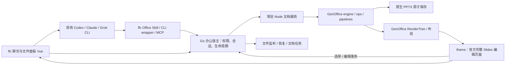

# ffc × GenOffice 集成与改造方案

更新时间：2026-10-15。本文替代 OfficeCLI 实时 PPT 方案，作为后续实现与验收依据。功能状态必须以本文末尾的实施记录为准；设计能力不等于已经实现。

## 1. 审查结论与范围

保留 ffc 的 Go/Wails、Vue 主界面、项目与聊天数据、多 CLI 执行器，接入 GenOffice 的原生办公引擎、事务操作和官方完整 Slides 编辑页面。编辑器独立构建，用 iframe 直接嵌在 ffc 文件面板内，使用官方菜单、页面列表、富文本编辑器与画布；正常编辑页面不叠加 ffc 自制工具栏。现有 Codex、Claude Code、Grok 等负责推理；办公服务负责确定性生成、修改、保存与渲染。

按用户最新要求，移除官方页面中的 Genspark AI、AI 美化、AI 事实核查、AI 配图四个入口。保留其他编辑界面，不另造一套简化编辑器。浏览器桥替代 Electron preload，依赖桌面主进程的菜单能力需逐项适配，嵌入整页不代表所有原生桌面操作已经可用。

本轮先完成 PPT 核心闭环：在文件面板内逐页看到生成，后续修改即时更新，最终保存原生可编辑 `.pptx`。Word、Excel、PDF 使用相同宿主协议逐步接入，不能把尚未接入的格式宣称为完整编辑器。

审查补充了以下缺项：

| 缺项 | 落地要求 |
| --- | --- |
| 只装 CLI 不能逐页看生成 | 合格单页立即进入打开的文档会话，事务提交后推送画布，不等待整份 `deck_build` |
| Go/Vue 与 Electron/React 不兼容 | 抽取不依赖 Electron 的引擎；官方 React/Konva 画布单独构建，使用宿主桥 |
| 多 CLI 与人工可能互相覆盖 | 同文件单一会话、串行事务、修订号、幂等请求；不同文件允许并行 |
| 已显示不一定已保存 | 分别报告 revision 与 savedRevision，失败保留文档和恢复副本 |
| 文件被 WPS/PowerPoint 改写 | 检测磁盘版本；干净会话重载，脏会话报告冲突，不自动覆盖 |
| 窗口/会话退出可能丢失结果 | 文档生命周期独立于聊天回合；关闭预览不取消后台任务，退出时清理子进程 |
| 临时 MCP 地址写入用户配置 | 同步稳定启动器，由运行时发现宿主并取得限定工作区的能力 |
| 包依赖与发行能力不清楚 | 固定提交、内部构建、完整依赖闭包、版本握手，不依赖未发布 SDK |
| Office 兼容性、字体与资源 | 实测中文字体、图片、图表、表格、母版与 round-trip；不支持时明确提示 |
| 二进制改动统计 | 显示文件数与页/元素操作摘要，不伪造代码增删行 |

## 2. 调研基线与源码事实

- 上游：<https://github.com/genspark-ai/genoffice>。
- 调研 main 提交：`2a607bd49bc341f74a60a8fa852183dfb6ce3c1f`。
- 调研时最新 release：`v0.11.727`，2026-10-13 UTC 发布，目标提交 `aff3d20aae749b64f87315093b26fd19e214c1d4`。
- 已对比 release 与 main 的 `slides-tools.ts`，两份文件 SHA-256 相同，确认该发行源码已有 Slides live 工具；未由此推断整个 release 与 main 相同。
- Apache-2.0，NOTICE 版权主体 Mainfunc, Inc.；需保留许可证、声明、修改说明及第三方许可，商标另行处理。
- 工程是 Electron 办公套件，Docs/Sheets/Slides/PDF/Markdown/HTML 与 Shell 分模块。Slides 使用 React 19/Konva，Docs 使用 Tiptap，Sheets 使用 Univer 与 Rust XLSX sidecar。
- 根工程要求 Node >=22.12；核心 npm 包为 private workspace，不能假设可直接安装稳定公开 SDK。

### 能力与边界

| 源码能力 | 能复用什么 | 仍需 ffc 实现什么 |
| --- | --- | --- |
| `pptx-engine` | OOXML 解析、原生形状/文字、字节锚点、元素 patch 保存 | 宿主路径授权、会话、保存冲突、进程打包 |
| `pptx-ops` / `runTxn` | 校验、原子事务、dry-run、持久元素 ID、图表/表格/页面等操作 | 修订检查、请求幂等、并发调度、恢复 journal |
| `pptx-render` | 字体度量、布局、独立 RenderTree | 字体与媒体供应、缓存、受控传输 |
| Slides 官方编辑页面 | 官方 Ribbon、页面列表、富文本编辑器、Konva 画布 | 浏览器 preload 桥、原生操作适配、桌面专属能力替代 |
| `pipelines/slides` | `parsePageSpec` / `buildPagePptx`、布局检查、原生单页生成 | 合格单页立刻插入现有会话，不等全 deck 构建 |
| Shell live MCP | `create_session` / `read_deck` / `apply_slide_ops` / `save_session` | 替换 Electron tab 控制；显式多文档地址与 ffc 权限 |
| CLI / stdio MCP / Skill | 结构读取、生成、修改、审查、CLI 可编程输出 | 与 ffc 当前 CLI、共享 MCP、运行时凭证打通 |

特别说明：CLI 的 PNG 渲染调用隐藏 Electron 应用导出 PDF，再经 PDFium 转 PNG。它不是纯 Node 小工具，也没有现成的 Watch HTML 服务。`preview.ts` 是文字预览。整页截图适合视觉检查和静态回退，不能作为每一次编辑的实时主路径。

`deck_page` 只暂存校验后的页面 spec，`deck_build` 会拒绝缺页的 deck。逐页可见必须增加 live 接入。源码已有本地单页生成 → 提取原生页面 → `insertSlidePptx` 事务的路线，应优先复用，避免重新发明一套完整 spec 转换器。

核心包存在交叉依赖，例如 pptx-ops 依赖 docx-engine，docx-engine 也依赖 pptx-engine；集成时固定完整闭包，不能只复制三个 package.json。字体解析、媒体处理、自动适应文本、撤销历史原来分布在 Electron main，需逐项迁移，不能直接把整个 main 导入 Node。

## 3. 方案比较与组件结构

| 方案 | 优点 | 问题 | 结论 |
| --- | --- | --- | --- |
| 只安装官方 CLI/Skill | 接入快，文件输出可靠 | 缺逐步可见、手动编辑、活跃文档修改闭环 | 作为诊断与备用入口 |
| 启动整套 Electron 窗口 | 最大程度复用完整产品 | 独立窗口、第二套 AI 设置，难融入 Wails 文件面板 | 不作为默认交互 |
| 抽取引擎与官方画布 | 应用内实时操作、复用原生编辑能力 | 需维护 fork、宿主桥与兼容性验证 | 推荐 |
| Vue 从零重写 OOXML 渲染 | 表面统一框架 | 重复实现 Office 布局，保真与维护成本高 | 不采用 |



责任边界：嵌入的官方编辑器绘制 GenOffice 产出的 RenderTree，不自行解析 OOXML。Agent 工具和人工编辑共享同一个后端文档会话；后端完成解析、布局、事务与保存。这里采用 GenOffice 官方编辑器架构，替代旧的 OfficeCLI Watch HTML；静态截图仅作为错误回退。

## 4. 核心交互与实时闭环

### 新建 PPT

1. 用户提出主题，沿用当前聊天 Agent 规划大纲和样式。
2. 工具创建限定输出路径的空文档会话，立即打开 ffc 预览；大纲可以显示为待生成页列表。
3. Agent 每生成一页调用 `office_page`；宿主校验 spec 与图片来源，调用上游单页 builder。
4. 单页源通过上游提取/合并接口变成 `insertSlidePptx` 事务，进入当前会话。native shape/text 保持可编辑。
5. 事务提交后立刻产生新 revision 和变更页 RenderTree，面板更新。文件保存使用快照与原子替换，独立显示 savedRevision。
6. Agent 可继续用低级 ops 分批添加元素，让页面细节逐渐形成；最终检查布局、保存、返回真实路径。

### 修改已有 PPT

1. 打开文件时建立或复用唯一文档会话，读取页面与元素 ID。
2. “第三页标题放大”先把自然语言页码 3 转为上游 index 2，再选定元素；优先使用 durable ID。
3. 提交 `setFont` 等元素事务，保留原页的母版、图片、动画、未知 OOXML；不要为局部修改重建整页。
4. 画布显示新内容，定位到变更页；用户关闭“跟随修改”后只刷新内容，不抢滚动位置和选中项。
5. 保存失败时保持画布与脏状态，允许重试或另存，不声称文件已更新。

### 多文档与用户操作

- 同一路径在多个标签/会话里共享同一 authoritative session；文档 ID 不能绑定某一回合的临时 HTTP server。
- 事务只在同一文档内串行，不把其他文件、聊天、标签切换与关闭按钮置灰。
- Agent 操作需携带 expectedRevision 与 requestId。冲突返回最新版本与概要，Agent 重新读取后修改。
- 人工拖动的临时预览不写 journal；鼠标释放一次提交。用户正在文字编辑时不覆盖输入缓冲。
- 自动打开首次生成文件，之后后台修改非活跃标签时标记更新，不反复强抢焦点。
- 关闭预览仅解绑视图。关闭文档遇脏内容提供保存/另存/保留后台选项；后台取消停在最近一次完整事务。

## 5. 宿主协议草案

统一工具入口：

| 工具 | 作用 |
| --- | --- |
| `office_open` | 按工作区相对路径打开/创建会话并显示预览 |
| `office_read` | 读取精简结构、元素 ID、修订号，不返回整份 RenderTree/base64 |
| `office_page` | 校验并生成原生单页，插入或明确替换，提交后实时可见 |
| `office_apply` | 原子操作批次、dry-run、expectedRevision、requestId |
| `office_save` | 保存指定 revision；失败区分冲突、文件锁与磁盘错误 |
| `office_snapshot` | 按需生成当前页面截图供视觉检查，限制尺寸与频率 |
| `office_selection` | 给 Agent 当前页/选中元素的语义定位 |

```ts
type OfficeRequest = {
  documentId: string
  expectedRevision: number
  requestId: string
  ops?: unknown[] // 验证必须使用上游 operation registry
}
type OfficeResult = {
  documentId: string
  revision: number
  savedRevision: number
  changedSlides: string[]
  warnings: string[]
}
type OfficeEvent = {
  sequence: number
  documentId: string
  revision: number
  kind: 'render' | 'saved' | 'external-change' | 'conflict' | 'error'
}
```

Go 与 Node 使用独立带 framing 的进程协议，日志只走 stderr；MCP 的 stdout 不与引擎协议混用。前端经宿主取事件/快照；优先推送，断线后用 sequence/版本补偿。SSE 使用带 Authorization 的 fetch stream，不能把长期 bearer token 放进 URL。页面/媒体按需获取，工具回复保持精简。

Agent wrapper 与 MCP 使用同一宿主 API。共享配置记录稳定的启动器，不把每次运行的 port/token 永久写入项目 `.mcp.json` 或用户 TOML。使用本轮限定 root 的能力；脱离 ffc 启动时返回明确“宿主未运行”，不意外编辑系统上的其他文件。

前端子模块以独立构建隔离 React/Vite/TS 版本。iframe 握手验证目标 origin、source 和随机 nonce；Wails 自定义 origin/WebView2 的实际行为必须在原生窗口验证。使用局部 bridge 或 MessageChannel，子画布没有 Wails 全局对象、任意文件读写或 shell 权限。

## 6. 保存、监听、冲突与恢复

- `revision` 表示已应用的内存修改，`savedRevision` 表示磁盘完整快照；不得因一次旧快照保存成功清除后续新修改的脏标志。
- 保存写同目录临时文件，校验 ZIP/必要 OOXML，再替换。Windows sharing violation 有限重试；原文件一直保持最后一份完整版本。
- 以大小、mtime 与必要内容哈希跟踪外部版本，识别自己的保存避免刷新环。监听事件合并，写入稳定后再解析，损坏/半写文件保留最后成功画面。
- 内存干净时可以接受外部版本；内存脏时停止覆盖，提示重载、另存或保留本地。重载不能默认丢弃人工修改。
- 内置恢复快照与 journal 在应用数据目录，记录版本和原始文件 hash；崩溃后提供恢复入口。Agent 中断不丢弃已提交页面。
- Undo/redo 以事务为单位，回合级 AI checkpoint 独立于普通撤销；执行撤销同样递增 revision 并推送画布。
- 同文件多个调用在文档队列中处理。Node 内重解析/大布局耗时不能堵住其他文档：后续使用文档 worker 与并发上限。

## 7. 字体、媒体、兼容性与性能

首期覆盖原生文本、基础形状、图片、常用表格/图表、页面顺序及备注。复杂 SmartArt、OLE、视频、3D、公式、动画和厂商扩展必须逐项验证，区分“可预览”“可编辑”“能保留”。只打开不修改也必须进行 round-trip 验证。

中文字体要求：后端度量与前端 FontFace 用相同字体；优先当前系统字体，缺失时提示替代。保留源字体名称，不把显示用替代字体默写入 PPTX。TTF/TTC/嵌入字体需使用上游解析策略；不擅自下载大字体包。

图片先通过 ffc 受控资源层处理，再交给 builder。没有明确联网需求时不调用上游云端 page generation/search/image，也不引入第二套 Genspark API key。SVG 必须防外部资源与脚本，未知图片格式显示明确警告。图片大字节不反复放进聊天上下文或全量事件。

性能验收目标而非当前实测：普通十页文档，工具成功至画布更新 P95 尽量低于 500ms；单页生成后不等待其他页；二十至一百页文档按需布局/缩略图虚拟化；图片按内容 hash 缓存，事件合并且有背压。首版若全量 RenderTree 成本过高，再按实际测试拆增量，不能先承诺任意大文件实时编辑。

截图模式必须提示静态状态。可以沿用现有 Office/WPS/LibreOffice PDF 服务作降级，或独立下载官方 Electron renderer 组件供导出；不要因为预览失败自动安装整套上游应用。

## 8. 安全、分发与升级

- 本地服务仅 `127.0.0.1` 随机端口，Host/Origin 限制、随机能力认证、限定 root、读写职责拆分。
- 每次读写重新解析路径，拒绝路径穿越、符号链接/Windows junction 越界、任意远端 URL和 UNC 逃逸。未来文件授权也要验证父目录。
- ZIP 体积/展开体积/entry 数量、ops 数量、图片大小、文档页数与运行时间有明确上限，并返回可读错误。
- 引擎不授予 shell；MCP 不暴露任意代码执行。Skill 的脚本调用有结构化 JSON 输出，不能执行模型拼接的脚本代码。
- 源码固定提交，最少改动 fork，原许可与修改说明随组件分发；第三方包/字体声明由构建生成并审核。
- Node runtime 与 office engine 单独组件版本，启动握手检查协议。优先应用管理的 runtime 或合格本地 Node，缺失时提供受校验的安装流程，不依赖用户手动配置 PATH。
- 更新后台进行，当前文档继续用旧版本；新组件在下次空闲启动使用，失败可回滚。组件检查不能阻塞聊天/关闭按钮。

## 9. 当前项目改造映射

| 现有模块 | 改造 |
| --- | --- |
| `internal/catagent` 多 CLI 执行 | 沿用，注入新的 ffc Office Skill/入口，不改对话/provider 系统 |
| `shared_extensions.go` / `shared_native.go` | 复用共享与原生配置同步，不覆盖用户自定义 MCP |
| `workspace_preview.go` | 保留通用打开文件；PPT 工具路由迁移 GenOffice，移除默认 OfficeCLI 提示 |
| `turn_changes.go` | 保留真实文件统计，后续增加办公事务页/元素摘要 |
| `CatFilesPanel.vue` | 保留分栏/文件标签，PPT 改用 GenOffice 画布；解除旧固定标签数与全局禁用的交互限制 |
| `CatPptxPreview.vue` / `catPptx.ts` | 替换实时主入口，保留显式静态回退 |
| `CatDocumentPreview.vue` / `internal/service/doc` | 保留 PDF、Office/WPS 转换 fallback，不能在“静态”时偷偷启动旧 OfficeCLI |
| `internal/officecanvas` | Title/Bullets 旧 IR 仅为历史骨架，不能宣称是 GenOffice 编辑器 |
| `internal/officecli`、旧 `pptskill` | 退出默认路由，确认没有使用者后再删除；不回退掉无关草稿与原生 steer 修复 |

## 10. 核心文件与构建边界

核心模块（当前落地路径）：

```text
office/package.json + package-lock.json        独立 workspace 与固定依赖
office/vendor/                                固定上游引擎及完整 Slides 页面、LICENSE/NOTICE
office/src/engine.ts                           Node 服务、会话与上游 adapter
office/src/editor.tsx                          官方 main 入口加载
office/src/slides-bridge.ts                     浏览器 preload、鉴权请求、版本轮询
office/src/editor-host.ts                       官方编辑意图到原生事务的适配
office/src/text-edit-overlay.tsx                保留人工编辑期间的原始节点与草稿
office/scripts/editor-profile.mjs              删除四个 AI 入口及并发编辑适配
office/scripts/build.mjs                       构建可嵌入 runtime
internal/genoffice/                            Go 进程宿主、资源与文档生命周期
internal/service/cat/genoffice.go               会话/工作区授权与文件面板连接
internal/service/cat/pptskill/                  内置 ffc-ppt-live Skill 与受控 CLI/MCP wrapper
frontend/src/api/catPptx.ts                     typed Wails bridge
frontend/src/components/cat/CatPptxPreview.vue   官方编辑页面 iframe 与错误回退
office/tests/engine.test.mjs                    原生文档与编辑意图测试
office/tests/browser.cjs                        真实 Vue + Go + Node + 官方编辑器验收
docs/genoffice-integration-plan.md             本方案与实施记录
```

示意代码（协议草案，不等于现成上游 API）：

```ts
await perDocumentQueue.run(id, async () => {
  checkRevisionAndRequestId(request)
  const plan = runTxn(session.opened, { ops, dryRun: true })
  requireValid(plan)
  // 使用上游事务结果，并迁移 main 的 autofit、reparse、history 处理。
  applyWithHistoryAndRollback(session, ops)
  session.revision++
  publishRender(session)
  scheduleAtomicSaveSnapshot(session)
})
```

Skill 引导：新建时先 open，再逐页 page 或分批 apply，每批完成用户即可看见；修改时先 read，按 durable ID 定位；最后 save 并核验 savedRevision。错误时修正 schema 或重读 revision，不默认用 force 覆盖打开的文档。

## 11. 实施阶段与验收

### A：源码抽取与运行验证

固定源码依赖、独立构建引擎/画布；真实生成两页 PPTX、应用内渲染、修改标题后刷新；证明不需要可见 Electron 窗口、不依赖第二套 AI。验证 Node 生命周期与 WebView2 嵌入。

### B：PPT 主闭环

接通工作区能力、Skill/wrapper、自动打开、逐页生成与 ops、原生保存、外部修改、错误回退；不同文档允许并行，同文档保护 revisions 和重试幂等。

### C：完整 PPT 工作流

迁移手动编辑、选择引导、事务撤销/redo、回合 checkpoint、崩溃恢复、页/元素变更摘要、受控截图与视觉修复、多标签状态与性能缓存。

### D：完整办公扩展

Word：docx-engine + Tiptap，段落 patch、选区编辑、分页与修订。Excel：xlsx-gateway + Rust sidecar + Univer，值/公式/样式/表格/图表，明确公式子集与 VBA 只保留不执行。PDF：复用已有阅读器，优先批注/转换，不能宣称任意 PDF 原文可无损编辑。HTML/Markdown：复用文本编辑器与沙箱预览。

每阶段有可运行结果后再更新状态，不能一次把六种格式全部标记完成。

必测场景：

1. 空目录生成 3 页；第 1 页完成即看见，最终文件能被 PowerPoint/WPS 打开并编辑文字。
2. 第 3 页文字放大、添加总结、移动/删除页；画布与保存后重开一致。
3. 导入用户 PPT；改一处文字，其他页/图片/母版保留，未知特性明确警告。
4. 两个 CLI 改不同文件；同文件相同 requestId 不重复加页，旧 revision 修改被拒绝。
5. 拖动宽度、缩放、切标签、关闭预览、持续对话；不出现零尺寸画布或全局禁用。
6. WPS 锁文件、磁盘写失败、半写 ZIP、服务崩溃、外部文件改写；不覆盖新版本或丢失最后完整结果。
7. 路径穿越/链接越界/未认证调用被拒绝；令牌不出现在对话、日志和 Git 配置中。

## 12. 风险与后续扩展

上游年轻且更新频繁，private API 可能变化：固定基线、保持薄 adapter、建立 import/生成/round-trip 集成测试，按版本升级。官方组件不是现成浏览器 SDK，抽取后的真实 WebView 运行与字体保真是第一阶段阻断条件。

Morph：源码有 transition ops，但必须测试命名、元素关联与 PowerPoint/WPS 播放；先保留转场与稳定名称，后续完善画布播放，不把静态预览当成动画支持。

视觉闭环：从当前页的成熟画布导出 PNG → 交给当前多模态 CLI → 限次提出原生 ops 修复；geometry audit 与实际视觉观察分别报告。后续支持模板库、跨文档生成、表格到图表、Office 文档语义 diff 和任务级恢复。

## 13. 上游证据

下列链接固定到调研提交，避免 main 漂移：

- [PPT 引擎](https://github.com/genspark-ai/genoffice/blob/2a607bd49bc341f74a60a8fa852183dfb6ce3c1f/packages/pptx-engine/src/index.ts)
- [操作层](https://github.com/genspark-ai/genoffice/blob/2a607bd49bc341f74a60a8fa852183dfb6ce3c1f/packages/pptx-ops/src/index.ts)
- [独立渲染树](https://github.com/genspark-ai/genoffice/blob/2a607bd49bc341f74a60a8fa852183dfb6ce3c1f/packages/pptx-render/src/render-tree.ts)
- [官方画布](https://github.com/genspark-ai/genoffice/blob/2a607bd49bc341f74a60a8fa852183dfb6ce3c1f/apps/slides/src/renderer/SlideCanvas.tsx)
- [Live MCP 桥](https://github.com/genspark-ai/genoffice/blob/2a607bd49bc341f74a60a8fa852183dfb6ce3c1f/apps/shell/src/main/mcp/slides-bridge.ts)
- [Slides tools](https://github.com/genspark-ai/genoffice/blob/2a607bd49bc341f74a60a8fa852183dfb6ce3c1f/apps/shell/src/main/mcp/tools/slides-tools.ts)
- [本地单页生成与落地](https://github.com/genspark-ai/genoffice/blob/2a607bd49bc341f74a60a8fa852183dfb6ce3c1f/apps/slides/src/main/slides-main.ts)
- [CLI 渲染实际实现](https://github.com/genspark-ai/genoffice/blob/2a607bd49bc341f74a60a8fa852183dfb6ce3c1f/packages/cli/src/formats/render.ts)
- [分阶段 deck MCP](https://github.com/genspark-ai/genoffice/blob/2a607bd49bc341f74a60a8fa852183dfb6ce3c1f/packages/cli/src/mcp/deck.ts)
- [Sheets 兼容性契约](https://github.com/genspark-ai/genoffice/blob/2a607bd49bc341f74a60a8fa852183dfb6ce3c1f/apps/sheets/docs/compatibility.md)
- [许可证与 NOTICE](https://github.com/genspark-ai/genoffice/blob/2a607bd49bc341f74a60a8fa852183dfb6ce3c1f/NOTICE)

## 14. 实施记录

- 方案与源码审查完成；固定上述 main 提交，vendor 保留上游源码，浏览器构建通过 `editor-profile.mjs` 做可审查的局部修改。随包保留 Apache-2.0、NOTICE、Carlito 字体 OFL 及第三方许可证。
- A/B 的 PPT 主链路已实现：Go 宿主懒启动常驻 Node 服务；官方完整 Slides 页面嵌入文件面板；CLI/Skill/MCP 和人工编辑共享文档会话，支持原生逐页生成、文字与形状修改、页面增删移动、表格/图表、备注、撤销/重做、原子保存及冲突另存副本。不同文档独立调度。
- 官方页面中的四个 AI 入口已删除，正常页面没有额外 ffc 工具栏。人工文字编辑固定本次编辑的原始节点与 revision；后台 Agent 发布新版本时保留输入，过期提交报错，冲突状态按 Esc 可取消本次编辑。
- 当前实时传输是 **200ms 版本轮询**（隐藏时 1200ms），版本变化返回整份 RenderTree；外部磁盘版本由宿主检测。此前正文中的 SSE、增量渲染、worker、缓存预算、follow 开关是后续设计，未实施，不能据此声称大文档性能已达标。后台本机服务仅监听 loopback，握手令牌不进入 iframe URL。
- 原生编辑元素使用 OOXML cNvPr 稳定标识，避免序列化重开后选择丢失；Agent 可继续用 durable GUID。支持内存事务历史和恢复 PPTX checkpoint，但完整 journal 重放、恢复选择 UI、任务级 checkpoint 与视觉截图工具仍待实现。
- 核心 Node 集成测试 **4/4 通过**，验证逐页生成、针对性修改、字号/autofit、原生形状/表格/图表、编辑 preview 不产生新 revision、undo/redo、幂等、路径权限、外部冲突、另存副本不覆盖、保存后 ZIP 与重开。Go 定向测试覆盖宿主授权、真实回合 Skill/MCP 和共享扩展；前端构建、主程序编译已通过。
- 真实浏览器链路（Vue 文件预览组件 → Go → Node → 官方编辑器）通过：第一页/第二页逐步出现、Agent 修改后刷新、官方富文本输入、撤销、人工草稿在 Agent 修改后保留、过期提交提示冲突、取消后看到 Agent 最新文字、官方菜单新建幻灯片、缩放、隐藏/重显及缩窄面板。DOM 断言四个 AI 入口不存在，正常页面无 ffc 附加工具栏。
- **边界：**尚未完整适配官方 Electron 的 OS 文件对话框、母版编辑、PDF 导出/打印和系统剪贴板；官方“另存为”提示通过 Agent 另存，CLI/MCP 可传 `copyPath`；不支持的编辑方法显示错误。未在原生 Wails/WebView2 窗口以及 PowerPoint/WPS 中完成保真对比，不能宣称整套 Office 已完成验收。
- C 部分实现（官方人工编辑、事务 undo/redo、多文档）；其余能力待实施。D 未实现：Word、Excel 的官方完整编辑页面仍需独立接入，现有静态文档预览继续承担回退。
- 全量 Go 测试和既有前端 API 检查仍有环境相关/断言失败，本次定向检查通过不代表全仓测试全绿；不扩大本阶段范围修改其他模块。
