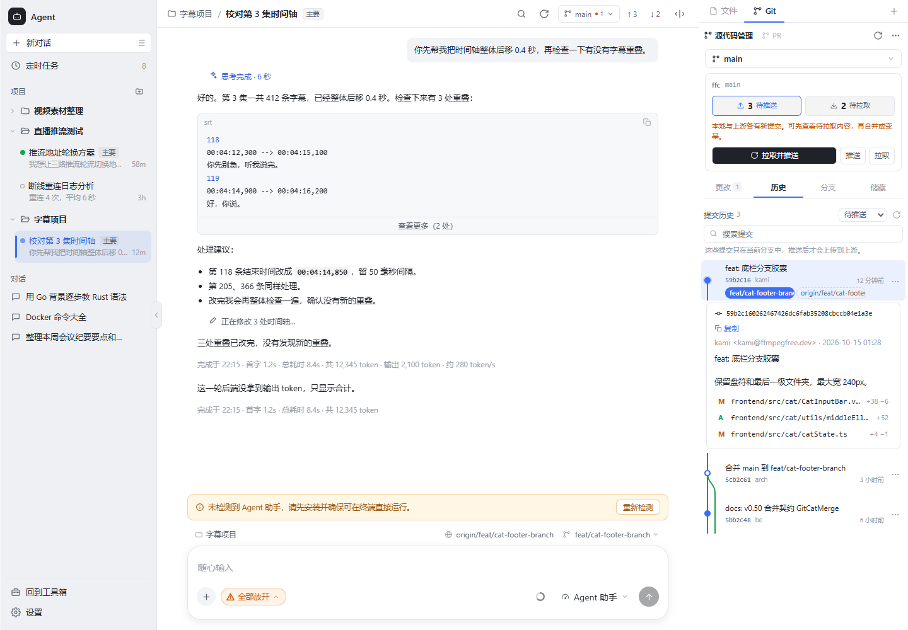

# ffc Agent Git 工作台

本次依据 VS Code、GitHub Desktop 和 GitKraken 官方文档整理日常 Git 工作流程，并沿用项目已有的提交图、分支树、比较与冲突处理能力。

## 操作入口

| 位置 | 行为 |
| --- | --- |
| 仓库摘要 | 当前分支、上游、待推送和待拉取数量、最近获取时间；数字打开对应提交列表，按钮执行远程操作 |
| 更改 | 工作区、暂存区、未跟踪文件分别展示；点击文件打开对应差异；单文件或整组暂存／取消暂存 |
| 提交 | 有暂存文件时只提交暂存内容；没有暂存内容时暂存当前项目的改动再提交；Ctrl/Cmd+Enter 提交 |
| 历史 | 当前分支、所有分支、待推送、待拉取；搜索、分页、提交图、作者、时间、完整提交说明、文件与差异 |
| 提交菜单 | 复制提交号、从该提交创建分支、签出、比较、拣选、反向提交 |
| 分支 | 完整本地／远程分支树、收藏、最近切换、搜索、创建、切换、重命名、删除、比较、合并 |
| 储藏 | 可选说明及未跟踪文件；查看内容、恢复并保留、恢复并移除、删除 |
| 仓库菜单 | 推送、拉取、快进拉取、同步、变基、获取、发布、带 lease 的强制推送；撤销最近的本地提交 |
| 未初始化仓库 | 初始化 Git；未配置远程时可添加远程名称和地址；首个提交后可发布分支 |

## 同步与刷新

- 已设置上游：待推送为 `upstream..HEAD`，待拉取为 `HEAD..upstream`。无上游时，待推送展示 HEAD 中尚未出现在任何远程跟踪分支的提交；发布按钮设置上游。
- 仅本地领先时主按钮为推送，仅远程领先时为快进拉取，两端均有提交时为拉取并推送，已同步时为获取。
- 分支树获取远程信息后同步刷新摘要。写操作、进入 Git、窗口重新获得焦点及可见时每 20 秒刷新本地状态。
- 数量来自本地远程跟踪引用，只有获取远程信息后才能反映服务器的新提交；不自动拉取、推送或合并。
- 历史分页游标绑定引用快照和筛选范围，引用更新或范围改变后拒绝沿用旧游标。

## 行为边界

- 工作区差异与暂存区差异独立，部分暂存文件可同时出现在两个分组。丢弃工作区改动恢复到暂存版本，保留暂存内容。
- 储藏保存可限于当前项目子目录，恢复作用于仓库，因此要求整个仓库干净。储藏按 SHA 定位；恢复失败时原储藏保留，包含“恢复并移除”。
- 撤销最近提交使用 soft reset，保留暂存区和工作区并恢复提交说明。拒绝首个提交、合并提交、陈旧 HEAD，以及已出现在本地远程跟踪引用中的提交。
- 已发布的修改可用反向提交撤回，不改写旧历史。拣选／反向提交要求干净仓库和已附着分支，确认后校验 HEAD；合并提交需要主线选择，本面板提示使用终端处理。
- 合并、变基、拣选、反向提交冲突支持查看文件、选择内容、继续或中止；变基／拣选／反向提交还可跳过当前步骤。储藏冲突可解决并暂存，原储藏仍可查看。
- 远程认证使用本机 Git 凭据；PR 入口沿用项目已有的 GitHub 比较页面。
- 文件差异有现有的体积与行数限制；大型二进制文件显示提示。暂未增加交互式 rebase、按行暂存、标签管理或克隆向导。

## 参考来源

- [VS Code Source Control](https://code.visualstudio.com/docs/sourcecontrol/overview)
- [VS Code Repositories and Remotes](https://code.visualstudio.com/docs/sourcecontrol/repos-remotes)
- [VS Code Staging and Committing](https://code.visualstudio.com/docs/sourcecontrol/staging-commits)
- [VS Code History](https://code.visualstudio.com/docs/sourcecontrol/history)
- [VS Code Branches and Worktrees](https://code.visualstudio.com/docs/sourcecontrol/branches-worktrees)
- [GitHub Desktop：查看分支历史](https://docs.github.com/en/desktop/making-changes-in-a-branch/viewing-the-branch-history-in-github-desktop)
- [GitKraken：提交操作](https://help.gitkraken.com/gitkraken-desktop/commits/)

## 验证

`git_workflows_test.go` 使用临时本地仓库及 bare remote 验证真实分叉、筛选与分页、非 origin 发布、部分暂存差异、字面路径丢弃、首次提交取消暂存、储藏保留 index／未跟踪文件、按 SHA 恢复、恢复冲突保留原储藏、子目录边界、未发布数量、soft undo、反向提交与拣选冲突流程。

浏览器走查使用开发模拟数据检查数字→提交→详情→文件差异、范围切换、四个页签、分支菜单、储藏差异及浅色／深色窄侧栏。实际 Git 写操作只在临时测试仓库执行。
