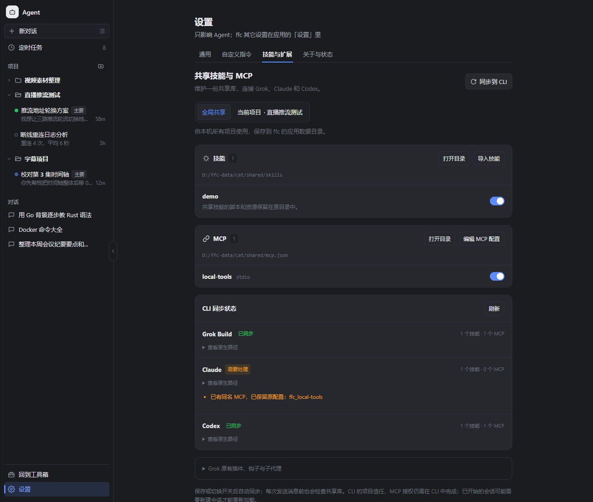

# Agent 共享技能与 MCP

入口：**Agent → 设置 → 技能与扩展 → 共享技能与 MCP**。

全局共享库位于应用数据目录的 `cat/shared/`，供本机项目使用；项目共享库继续使用 `<项目>/.ffmpegfree/cat/`。两种范围都包含 `skills/<name>/SKILL.md`、`mcp.json`、`enabled.json` 和同步所有权记录 `native-sync.json`。

导入选择一个带有 `SKILL.md` 的文件夹，连同脚本、资源一起复制到共享库。技能元数据需有有效的 `name` 和 `description`。手动放入共享库时，目录名与技能名应相同。原生目录连接到同一份共享文件；后续修改共享库中的文件，三家 CLI 都能看到。Windows 使用目录符号链接或原生 junction API，其他系统使用符号链接。

| CLI | 全局技能 | 项目技能 | 全局 MCP | 项目 MCP |
| --- | --- | --- | --- | --- |
| Grok Build | `~/.grok/skills` | `.grok/skills` | `~/.grok/config.toml` | `.grok/config.toml` |
| Claude | `~/.claude/skills` | `.claude/skills` | `~/.claude.json` | `.mcp.json` |
| Codex | `~/.agents/skills` | `.agents/skills` | `~/.codex/config.toml` | `.codex/config.toml` |

尊重 `GROK_HOME`、`CODEX_HOME` 和 `CLAUDE_CONFIG_DIR`；Claude 自定义目录的用户 MCP 文件是 `<CLAUDE_CONFIG_DIR>/.claude.json`。不再注入未经确认的 `*_SKILLS_DIR` / `MCP_CONFIG_PATH`。

共享 MCP 格式：

```json
{
  "mcpServers": {
    "local-tools": {
      "command": "your-mcp-command",
      "args": [],
      "env": {}
    },
    "remote-tools": {
      "type": "http",
      "url": "https://your-server.example/mcp",
      "headers": {}
    }
  }
}
```

支持 stdio、HTTP 和可选的 SSE。Codex 不支持旧式 SSE 时会显示兼容性提示，其余 CLI 仍可同步。共享 MCP 在原生配置中使用 `ffc_` 前缀。常规状态响应只包含名称、传输类型、路径和结果，不返回命令参数、环境变量或请求头中的密钥；打开配置编辑器时才读取明文。

保存、导入及开关操作自动同步；普通对话和定时任务的 CLI 启动前也会同步，拾取外部修改。各条目独立显示忙碌状态。MCP 编辑器保存后立即关闭，失败时保留对应范围的草稿。原有 Grok 插件、钩子和子代理保留只读查看。

同步只接管 ffc 创建的链接和 MCP 项。已有同名目录或配置不会被覆盖，即使内容完全相同也不会自动接管。外部修改过的已同步项会保留，并显示冲突；可通过“查看原生路径”和“打开目录”检查。停用只移除仍匹配所有权记录的原生项，不删除共享技能原文件。启用状态文件和同步记录损坏时拒绝不确定的写入；单个无效技能或无效 MCP 源不会阻止其他有效扩展同步。

首次修改已有原生配置会保留 `.ffc-backup`。配置原子写入前检查是否被外部修改；内部操作串行保护配置合并。TOML 重写保留配置值，但会重新排版并移除原注释，原文在备份中。项目范围会产生本地原生配置和技能链接；编辑器中的环境变量和请求头若含密钥，不应提交到仓库。

CLI 的项目信任、MCP 授权与 OAuth 仍由各 CLI 自己处理。已运行的会话可能需要新建会话才能重新加载。这里的“已同步”表示原生目录和配置已写入，不能等同于服务已经连接成功；同步不会启动 MCP 服务或进行模型推理。

验证：

- Windows 三家原生目录链接的读写、停用恢复、原文件保留、配置备份、同名冲突、外部编辑、只读检查、非法同步记录、传输转换通过 Go 测试。
- 服务层的完整技能资源导入、全局/项目隔离、并发开关、配置验证、密钥不进入状态响应、损坏项隔离和发送前同步通过 Go 测试。
- 本机 Codex app-server 只读 `skills/list` 发现 junction 链接技能，`config/read` 在隔离的已信任测试项目中读到共享 MCP。
- 本机 Claude `mcp get` 读取生成的项目 MCP，另验证了 `CLAUDE_CONFIG_DIR` 对用户 MCP 文件的实际路径。
- 本机 Grok `inspect --json` 读取生成的 MCP，并保留其未信任项目状态。Claude 技能发现依据官方目录/符号链接文档；Grok 技能路径依据本机 bundled skill 文档，未通过推理绕过项目限制。
- 浏览器检查覆盖并发开关、后台保存、关闭编辑器、范围切换、独立草稿、失败恢复、损坏配置修复入口、冲突提示、深浅主题与 1024px 桌面宽度。

Claude 文档来源：[Skills](https://code.claude.com/docs/en/skills)、[MCP](https://code.claude.com/docs/en/mcp)、[CLI reference](https://code.claude.com/docs/en/cli-reference)。OpenAI 官网此次访问返回 403，因此 Codex 行为依据本机已安装 CLI 的帮助、生成的 JSON schema 和上述实际只读发现验证，没有把未获取到的网页当作证据。

本次全量 Go 测试同时观察到安装于本机的 CLI 探测、Windows 路径断言和旧 transcript fixture 等环境相关失败；共享功能测试、相关旧技能测试及构建单独验证。全量失败项包括 `TestDetect_MissingWithoutGrok`、`TestClaudeDetect_Missing`、`TestLoadTranscript_ReadsExport`、`TestDetectTimeoutFlagsThenLateResultApplies`、`TestBranchRepoKeyWindows`、`TestBranchTreeFavoritesPerRepo`、`TestCreateCatProjectValidationAndDedup`、`TestRelocateCatProject`、`TestSendWhenNotReady`。


